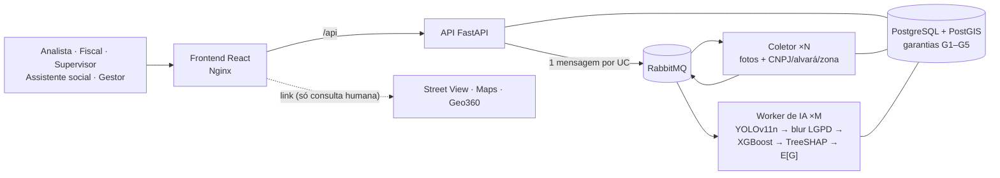

# Radar Cadastral SANEAGO

**Sistema Inteligente de Apoio à Atualização Cadastral de Imóveis para Concessionárias de Saneamento**


Projeto Integrador · SENAI FATESG · Inteligência Artificial · 3º período · 2/2026
Adriano Silva dos Santos · Bárbara Godoy · Melissa Cunha Leite · Nicolas Rocha de Sousa · Walisson Alves

---

Imóveis cadastrados como **residenciais** passam a ter uso **comercial** ou **industrial** e
continuam pagando a tarifa residencial. Na outra ponta, famílias com direito à **Tarifa
Social** não recebem o desconto. Hoje as duas situações dependem de vistoria presencial "no
escuro" ou de o próprio morador pedir o benefício.

O Radar Cadastral cruza **fotos de fachada**, **histórico de consumo** e **bases públicas**
(CNPJ, alvarás, zoneamento) para montar uma **fila de vistoria ordenada pelo ganho anual
esperado**, com a explicação de cada indicação. O mesmo sistema cruza o **CadÚnico** com o
cadastro para encontrar famílias elegíveis à Tarifa Social, em um módulo isolado.

> **Regra de Ouro.** A IA **nunca** altera a categoria tarifária. Ela recomenda e explica; a
> categoria só muda depois do laudo de um fiscal e da decisão de um supervisor diferente do
> fiscal, após o prazo de contestação. A regra é garantida pelo próprio banco de dados.

## Resultados em uma tabela

Teste fora da amostra em dados **sintéticos** (967 UCs residenciais, 119 irregulares), topo
de 10% da fila. Detalhes, intervalos e limitações em [docs/04](docs/04_PROTOCOLO_EXPERIMENTAL_E_METRICAS.md).

| | Regras de especialista | **Radar (XGBoost + visão + bases)** |
|---|---|---|
| Precisão nos 10% primeiros | 0,557 | **0,753** |
| Receita recuperável capturada nos 10% primeiros | 75,4% | **93,6%** |
| AUC-PR | 0,643 | **0,933** |
| Comércio informal sem CNPJ encontrado | 0% | **66,7%** |
| Razão de erro entre faixas de renda (I5, limite 1,25) | 2,32 | 1,90 (dispara revisão) |
| *Speedup* com 3 réplicas (lote de 300 UCs) | — | **1,98×** |

## Arquitetura



Detalhes: [docs/01 — Relatório Técnico de Arquitetura](docs/01_RELATORIO_TECNICO_ARQUITETURA.md).

## Quickstart

Requisitos: Docker Desktop (8 GB de memória recomendados) e Git. No Windows, use o Git Bash.

```bash
git clone <url-do-repositorio> radar-cadastral-saneago
cd radar-cadastral-saneago
cp .env.example .env

# 1. Subir tudo (a primeira vez leva de 10 a 20 minutos)
docker compose up -d --build

# 2. Conferir as garantias do banco (19 verificações)
bash db/tests/verificar_garantias.sh

# 3. Gerar as fotos de fachada simuladas
docker compose --profile experimentos run --rm experiments python gerar_acervo.py
```

4. Abra **http://localhost:5173**, entre como `analista` / `analista123`, crie um lote em
   **Processamento** e veja a **Fila de vistoria**.
5. Siga o fluxo com as outras contas (senha = login + `123`): `fiscal` registra o laudo,
   `supervisor` decide e aplica, `social` cuida da Tarifa Social, `gestor` vê os indicadores.

| Endereço | O quê |
|---|---|
| http://localhost:5173 | Aplicação web |
| http://localhost:8000/docs | API (Swagger) |
| http://localhost:15672 | Painel do RabbitMQ (`radar` / `radar_dev`) |

Manual completo: [docs/05 — Implantação e Operação](docs/05_MANUAL_IMPLANTACAO_E_OPERACAO.md).

## Documentação científica e técnica

| Documento | Conteúdo |
|---|---|
| [01 — Relatório Técnico de Arquitetura](docs/01_RELATORIO_TECNICO_ARQUITETURA.md) | Microsserviços, mensageria, DER, garantias G1–G5, escalabilidade, **Computação Paralela** e *speedup* medido |
| [02 — Metodologia de IA e Data Mining](docs/02_METODOLOGIA_IA_E_DATA_MINING.md) | YOLOv11 e classes, anonimização LGPD, 26 atributos, XGBoost, tarifa SANEAGO 2026, **Ganho Esperado**, linha de base, TreeSHAP, Tarifa Social |
| [03 — Ética, Equidade e Model Card](docs/03_ETICA_EQUIDADE_E_MODEL_CARD.md) | *Model Card*, LGPD, Street View e CadÚnico, *Human-in-the-Loop*, fórmulas de **I1 a I5**, auditoria de viés territorial |
| [04 — Protocolo Experimental e Métricas](docs/04_PROTOCOLO_EXPERIMENTAL_E_METRICAS.md) | Hipóteses, teste retroativo, ablação, métricas, resultados, piloto com grupo controle, ameaças à validade, modelo da seção de Resultados |
| [05 — Manual de Implantação e Operação](docs/05_MANUAL_IMPLANTACAO_E_OPERACAO.md) | Instalação, variáveis de ambiente, API REST, manual do usuário, solução de problemas, reprodutibilidade |

READMEs por módulo: [API](services/api/README.md) · [Frontend](services/frontend/README.md) ·
[Experimentos](experiments/README.md).

## Estrutura do repositório

```text
radar-cadastral-saneago/
├── docker-compose.yml          # orquestração (db, rabbitmq, seed, api, collector, ai_worker, frontend, experiments)
├── .env.example                # variáveis de ambiente (copiar para .env)
├── db/
│   ├── init/                   # schema, tarifas 2026, papéis, garantias G1–G5 (SQL)
│   ├── seed/                   # 30 UCs curadas de Goiânia + geração procedural
│   └── tests/                  # verificar_garantias.sh
├── services/
│   ├── comum/radar_comum/      # tarifas, Ganho Esperado, atributos, mensagens, topologia AMQP
│   ├── api/                    # FastAPI: lotes, fila, ordens, laudos, indicadores I1–I5, Tarifa Social
│   ├── collector/              # coleta de fotos (leituristas, Mapillary, Geo360) e bases públicas
│   ├── ai_worker/              # YOLOv11n, anonimização, XGBoost, TreeSHAP; modelos/ com os pesos
│   └── frontend/               # React + Vite + Tailwind, servido por Nginx
├── experiments/                # benchmark, treino do YOLO, acervo, speedup; resultados/ para o artigo
└── docs/                       # documentação científica (01 a 05)
```

## Princípios de governança

| Garantia | O que impede |
|---|---|
| **G1** | Mudar a categoria fora do laudo aprovado (nem a IA, nem *scripts*) |
| **G2** | Usar o CadÚnico para fiscalizar |
| **G3** | Gravar imagem sem anonimizar ou sem data de expurgo |
| **G4** | Usar Street View na inferência automatizada |
| **G5** | Editar ou apagar a trilha de auditoria |

## Limitações

* Todos os resultados vêm de **dados sintéticos**; o desempenho em campo será medido em piloto
  com grupo controle e amostra aleatória ([docs/04 §6](docs/04_PROTOCOLO_EXPERIMENTAL_E_METRICAS.md#6-protocolo-do-piloto-em-campo)).
* Coordenadas aproximadas por bairro e renda ilustrativa; os links de mapa da demonstração não
  apontam para imóveis reais.
* O detector foi treinado em fachadas geradas por programa e precisa de *fine-tuning* com fotos
  reais dos leituristas.
* Premissas tarifárias marcadas no banco precisam ser confirmadas com a concessionária.
* O Ultralytics YOLO é licenciado sob **AGPL-3.0**; uso comercial exige avaliação jurídica.

## Referências normativas

Resolução Conjunta AGR/ARM nº 1/2026 (tarifas SANEAGO) · Lei nº 14.898/2024 (Tarifa Social de
Água e Esgoto) · Relatório de AIR nº 17/2026 da AGR (ICTS) · Lei nº 13.709/2018 (LGPD) ·
Termos de Serviço do Google Maps Platform.
