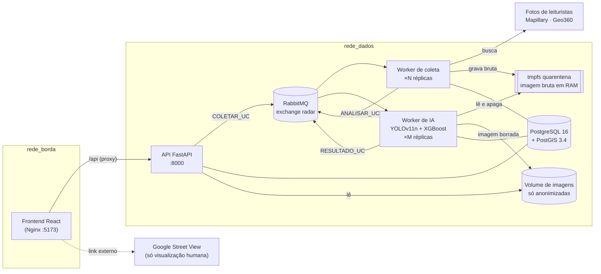
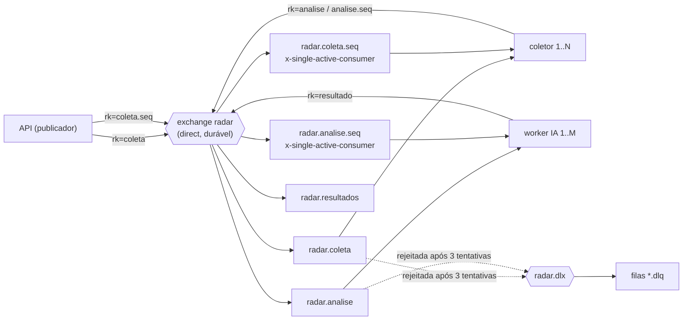
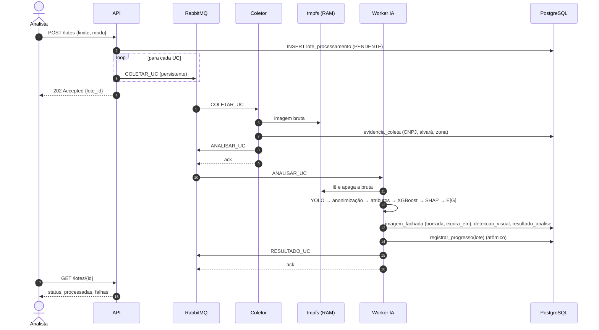
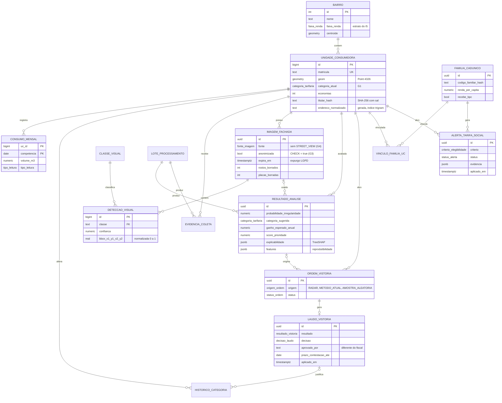
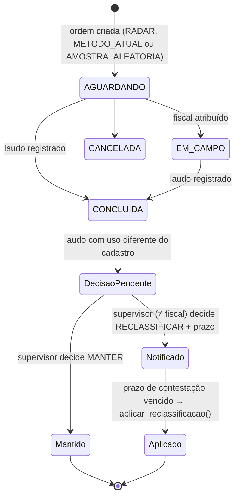

# 01 — Relatório Técnico de Arquitetura

**Radar Cadastral SANEAGO** — Sistema Inteligente de Apoio à Atualização Cadastral de Imóveis
para Concessionárias de Saneamento.

SENAI FATESG · Inteligência Artificial · 3º período · 2/2026

> **Escopo deste documento.** Especificação formal da arquitetura distribuída, do fluxo de
> mensageria, da modelagem de dados (DER), das garantias de governança implementadas no banco,
> da análise de escalabilidade horizontal e da fundamentação de Computação Paralela, com os
> resultados medidos do experimento de *speedup*. A metodologia de IA está em
> [02](02_METODOLOGIA_IA_E_DATA_MINING.md); ética e indicadores em
> [03](03_ETICA_EQUIDADE_E_MODEL_CARD.md); protocolo experimental em
> [04](04_PROTOCOLO_EXPERIMENTAL_E_METRICAS.md); operação em
> [05](05_MANUAL_IMPLANTACAO_E_OPERACAO.md).

---

## Sumário

1. [Requisitos que orientam a arquitetura](#1-requisitos-que-orientam-a-arquitetura)
2. [Visão geral e estilo arquitetural](#2-visão-geral-e-estilo-arquitetural)
3. [Componentes](#3-componentes)
4. [Fluxo de mensageria](#4-fluxo-de-mensageria)
5. [Modelagem de dados (DER)](#5-modelagem-de-dados-der)
6. [Garantias de governança no banco (G1–G5)](#6-garantias-de-governança-no-banco-g1g5)
7. [Segurança e controle de acesso](#7-segurança-e-controle-de-acesso)
8. [Escalabilidade horizontal](#8-escalabilidade-horizontal)
9. [Computação Paralela: fundamentação e resultados](#9-computação-paralela-fundamentação-e-resultados)
10. [Decisões arquiteturais (ADRs resumidos)](#10-decisões-arquiteturais-adrs-resumidos)
11. [Limitações e trabalhos futuros](#11-limitações-e-trabalhos-futuros)

---

## 1. Requisitos que orientam a arquitetura

| Id | Requisito | Origem | Consequência arquitetural |
|---|---|---|---|
| RF1 | Ranquear UCs residenciais pelo **Ganho Esperado** de reclassificação | Res. Conjunta AGR/ARM nº 1/2026; Entrega 04 | Cálculo tarifário em um pacote único (`radar_comum.tarifas`) espelhado por função SQL de referência |
| RF2 | Identificar famílias elegíveis à **Tarifa Social** fora do benefício | Lei 14.898/2024; AIR AGR nº 17/2026 | Módulo isolado com papel de banco próprio (`radar_social`) |
| RF3 | Explicar cada recomendação (XAI) | Ética em IA (PI, seção 7.3) | Explicação gravada junto do resultado (`explicabilidade` em JSONB) |
| RF4 | Fluxo de **decisão humana** com prazo de contestação | Regra de Ouro | Categoria só muda por função do banco a partir de laudo aprovado |
| RNF1 | Processar milhares de imagens por ciclo | Computação Paralela (PI, 7.1) | Fila de trabalho com consumidores competindo; uma mensagem por UC |
| RNF2 | Escalar sem alterar código | Sistemas Distribuídos (PI, 7.2) | Workers *stateless*; `docker compose --scale` |
| RNF3 | LGPD: minimização, finalidade e retenção | Lei 13.709/2018, art. 6º | Imagem bruta só em RAM (*tmpfs*); persistência só anonimizada e com data de expurgo |
| RNF4 | Street View **não** pode alimentar inferência | Termos do Google Maps Platform | O domínio `fonte_imagem` não tem valor para Street View; o link existe só no frontend |
| RNF5 | Reprodutibilidade científica | Base para artigo | Sementes fixas, contrato de atributos único, experimentos em contêiner |

## 2. Visão geral e estilo arquitetural

O sistema segue o estilo **microsserviços orientados a mensagens**: uma API síncrona recebe
pedidos e publica trabalho; dois tipos de *worker* consomem filas do RabbitMQ; o estado
persistente fica em um único PostgreSQL/PostGIS, organizado por **schemas de finalidade**.
A unidade de trabalho é **uma Unidade Consumidora (UC)**, o que torna o processamento de um
lote **embaraçosamente paralelo** (ver seção 9).



**Figura 1.** Arquitetura de implantação. As redes Docker separam a borda (frontend) dos
serviços de dados; somente a API está nas duas.

### 2.1 Serviços do `docker-compose.yml`

| Serviço | Imagem/Build | Papel | Escala | Rede |
|---|---|---|---|---|
| `db` | `postgis/postgis:16-3.4` | Persistência, garantias G1–G5 | 1 | dados |
| `rabbitmq` | `rabbitmq:3.13-management` | *Broker* AMQP 0-9-1, filas duráveis, DLX | 1 | dados |
| `seed` | `db/seed` | Carga inicial (30 UCs curadas + `SEED_EXTRA_UCS` procedurais) | execução única | dados |
| `api` | `services/api` | REST, autenticação JWT, publicação de lotes, indicadores | 1 (*stateless*) | dados + borda |
| `collector` | `services/collector` | Coleta de imagem e cruzamento com bases públicas | `COLLECTOR_REPLICAS` | dados |
| `ai_worker` | `services/ai_worker` | Visão computacional, anonimização, classificação, XAI, Ganho Esperado | `AI_WORKER_REPLICAS` | dados |
| `frontend` | `services/frontend` | React (Vite + Tailwind) servido por Nginx; *proxy* `/api` | 1 | borda |
| `experiments` | mesma imagem do `ai_worker` | Benchmark, treino, relatório de *speedup* | perfil `experimentos` | dados |
| `baseline` | mesma imagem da `api` | Linha de base por regras | perfil `ferramentas` | dados |

## 3. Componentes

### 3.1 API (`services/api`)

FastAPI assíncrona com *pool* de conexões `psycopg` e cliente `aio-pika`. Responsabilidades:

* autenticação (JWT, perfis `ANALISTA`, `FISCAL`, `SUPERVISOR`, `GESTOR`, `ASSISTENTE_SOCIAL`);
* criação de **lotes** de análise e publicação de uma mensagem `COLETAR_UC` por UC;
* consulta da **fila priorizada** (`fiscalizacao.vw_fila_priorizada`);
* ciclo de vida de **ordens, laudos e decisões**;
* cálculo dinâmico dos **indicadores I1–I5** (ver [03](03_ETICA_EQUIDADE_E_MODEL_CARD.md));
* módulo **Tarifa Social**, executado por uma segunda conexão com o papel `radar_social`.

A API mantém **duas conexões com credenciais distintas**: `usr_api` (sem acesso ao schema
`social`) e `usr_api_social` (acesso apenas ao necessário para a Tarifa Social). A separação
é de finalidade (LGPD, art. 6º, I), e não apenas de código.

### 3.2 Worker de coleta (`services/collector`)

Para cada `COLETAR_UC`:

1. procura a melhor foto de fachada entre as fontes configuradas (`FONTES_IMAGEM`):
   acervo de **leituristas**, **Mapillary** (Graph API v4) e **Geo360 Goiânia** (URL por acordo).
   Uma fonte `streetview` é **rejeitada** na montagem das fontes;
2. grava a imagem bruta **apenas** no *tmpfs* `quarentena_imagens` (RAM);
3. cruza a UC com CNPJ, alvarás e zoneamento por proximidade e endereço normalizado
   (`radar_comum.evidencia`), **sem** acessar o CadÚnico;
4. registra `analise.evidencia_coleta` e publica `ANALISAR_UC`.

### 3.3 Worker de IA (`services/ai_worker`)

Para cada `ANALISAR_UC`:

1. lê a imagem da quarentena e executa o **YOLOv11n** (9 classes);
2. **anonimiza** rostos e placas de veículos (pixelização + desfoque gaussiano, com detector
   Haar como segunda camada) e **apaga** a imagem bruta;
3. grava somente a imagem borrada, com `expira_em = capturada_em + RETENCAO_IMAGENS_DIAS`;
4. monta o vetor de atributos (`radar_comum.features`), aplica o **XGBoost** e calcula a
   explicação **TreeSHAP**;
5. calcula o **Ganho Esperado** e o *score* de prioridade (`radar_comum.ganho`);
6. grava `analise.resultado_analise`, atualiza o progresso do lote de forma atômica
   (`analise.registrar_progresso`) e publica `RESULTADO_UC`.

Um laço assíncrono de **expurgo** apaga as imagens vencidas (`analise.imagens_a_expurgar()`).

### 3.4 Pacote compartilhado (`services/comum/radar_comum`)

| Módulo | Conteúdo |
|---|---|
| `tarifas.py` | Estrutura tarifária SANEAGO 2026 e `fatura_mensal`, espelho da função SQL `regulatorio.fatura_mensal` |
| `ganho.py` | $\mathbb{E}[G]$, categoria sugerida, *score* de prioridade |
| `features.py` | **Contrato único** de atributos (26 atributos; grupos C, B, V), usado em produção e nos experimentos |
| `topologia.py` | Declaração idempotente de *exchanges*, filas e DLQs |
| `mensagens.py` | Contratos Pydantic das mensagens AMQP (versão 1) |
| `worker_base.py` | Consumo com *ack* manual, retentativas e *dead-letter* |
| `evidencia.py` | Cruzamento espacial e textual com bases públicas |
| `tarifa_social.py` | Vínculo família → UC (*record linkage*) e geração de alertas |
| `baseline.py` | Linha de base por regras de especialista |

Compartilhar esse pacote entre API, workers e experimentos elimina a **divergência
treino/serviço** (*training–serving skew*): o vetor de atributos avaliado no artigo é
exatamente o que o worker calcula em produção.

### 3.5 Frontend (`services/frontend`)

React 19 + Vite + Tailwind v4, servido por Nginx, que também atua como *proxy* reverso de
`/api` (mesma origem, sem CORS). Telas por perfil: fila de vistoria (com *bounding boxes*,
explicação, links de Street View, Google Maps e Geo360 só para consulta humana), vistorias
(laudo cego, decisão e aplicação), indicadores I1–I5, processamento de lotes, Tarifa Social e
auditoria. Detalhes de uso em [05](05_MANUAL_IMPLANTACAO_E_OPERACAO.md#6-manual-do-usuário).

## 4. Fluxo de mensageria

### 4.1 Topologia



**Figura 2.** Topologia AMQP declarada por `radar_comum.topologia`.

* **Modo PARALELO:** filas `radar.coleta` e `radar.analise`; vários consumidores competem
  (*competing consumers*), e o *broker* distribui por *round-robin* limitado por `prefetch`.
* **Modo SEQUENCIAL:** filas `.seq` com `x-single-active-consumer`. Mesmo com várias réplicas
  no ar, o *broker* entrega a fila a **um único consumidor por vez**. Assim, o baseline
  sequencial roda **na mesma infraestrutura** do paralelo, e a única variável manipulada no
  experimento de *speedup* é o grau de paralelismo.

### 4.2 Sequência de um lote



**Figura 3.** Diagrama de sequência do processamento de um lote.

### 4.3 Contratos e semântica de entrega

As mensagens são JSON (Pydantic, `versao = 1`) com `mensagem_id`, `lote_id`, `uc_id`,
`modo` e `tentativa`. A entrega é **pelo menos uma vez** (*at-least-once*):

* o *ack* só é enviado **depois** que o efeito foi gravado no banco;
* em erro, a mensagem é republicada com `tentativa + 1`;
* após `MAX_TENTATIVAS = 3`, vai para a DLQ, e a UC é contabilizada como **falha** do lote
  (sem perda silenciosa);
* o fechamento do lote (`CONCLUIDO` / `CONCLUIDO_COM_FALHAS`) é feito por
  `analise.registrar_progresso`, que incrementa contadores com `UPDATE … RETURNING`
  numa única transação, de modo que réplicas concorrentes não perdem atualizações.

Como a entrega pode duplicar mensagens, os efeitos são **idempotentes no nível de negócio**:
o resultado é um novo registro de análise (a fila usa sempre a última, por
`analise.vw_ultima_analise`) e nenhum efeito altera a categoria tarifária.

## 5. Modelagem de dados (DER)

O banco é organizado em **schemas por finalidade**, de modo que a permissão de acesso
acompanhe a finalidade do dado (LGPD, art. 6º, I):

| Schema | Finalidade | Quem acessa |
|---|---|---|
| `regulatorio` | Tarifas 2026 e parâmetros normativos (com flag `premissa`) | todos (leitura) |
| `cadastro` | UCs, consumo, bairros, histórico de categoria | API, workers |
| `publico` | CNPJ, alvarás, zoneamento | coletor, API |
| `social` | CadÚnico/BPC, vínculos e alertas | **somente** `radar_social` |
| `analise` | Lotes, imagens anonimizadas, detecções, evidências, resultados | workers, API |
| `fiscalizacao` | Ordens, laudos, custos | API |
| `auditoria` | Trilha *append-only* | gravação por *trigger*; leitura pela API |
| `experimento` | Gabarito sintético e execuções de benchmark | `radar_experimento` |



**Figura 4.** DER simplificado (entidades principais e atributos relevantes para o artigo).
O schema completo está em `db/init/01_init.sql`.

### 5.1 Visões e funções relevantes

| Objeto | Tipo | Finalidade |
|---|---|---|
| `regulatorio.fatura_mensal(cat, m³, economias, esgoto, vigência)` | função | Oráculo da regra tarifária; testes conferem a implementação Python contra ela |
| `analise.vw_ultima_analise` | visão | Última análise por UC (`DISTINCT ON`) |
| `fiscalizacao.vw_fila_priorizada` | visão | UCs residenciais ativas, sem ordem aberta, ordenadas por `score_prioridade` |
| `social.vw_elegibilidade` | visão | Critério da Lei 14.898/2024 (renda ≤ ½ SM ou BPC) |
| `analise.registrar_progresso(lote, sucesso, worker)` | função | Contador atômico e fechamento do lote |
| `fiscalizacao.aplicar_reclassificacao(laudo)` | função `SECURITY DEFINER` | **Única** porta de mudança de categoria por fiscalização |
| `social.aplicar_inclusao_tarifa_social(alerta)` | função `SECURITY DEFINER` | **Única** porta de inclusão na Residencial Social |

### 5.2 Ciclo de vida da ordem e do laudo



**Figura 5.** Estados da ordem e do laudo. A mudança de categoria só acontece no último passo,
por função do banco.

## 6. Garantias de governança no banco (G1–G5)

As regras críticas foram implementadas **no banco**, e não só na API, para que nenhuma falha
de código, *script* manual ou componente de IA as contorne.

| Garantia | Regra | Mecanismo |
|---|---|---|
| **G1** | A categoria tarifária só muda por decisão humana | *Trigger* `cadastro.fn_proteger_categoria` rejeita `UPDATE` de `categoria_atual` fora das duas funções `SECURITY DEFINER`; nenhum papel de IA tem `UPDATE` em `cadastro` |
| **G1a** | Reclassificação exige **segregação de funções** | `CHECK (aprovado_por <> fiscal_matricula)` em `laudo_vistoria`; a função recusa laudo já aplicado ou sem decisão `RECLASSIFICAR` aprovada |
| **G2** | CadÚnico só para a Tarifa Social | Schema `social` acessível apenas a `radar_social`, que **não** herda `radar_base` |
| **G3** | Só imagens anonimizadas e com prazo de retenção | `CHECK (anonimizada)`; `expira_em NOT NULL` e `> capturada_em`; expurgo periódico |
| **G4** | Street View não é fonte de inferência | O tipo `analise.fonte_imagem` só admite `LEITURISTA`, `MAPILLARY`, `GEO360_GOIANIA`, `SINTETICA` |
| **G5** | Auditoria imutável | *Triggers* de auditoria em ordens, laudos, alertas e lotes; `UPDATE`/`DELETE` em `auditoria.evento` bloqueados |

O *script* `db/tests/verificar_garantias.sh` executa 19 verificações negativas (tentativas
de violar cada garantia com o papel errado) e falha se alguma passar.

## 7. Segurança e controle de acesso

* **Papéis de banco** com mínimo privilégio: `radar_api`, `radar_coletor`, `radar_ia`,
  `radar_social`, `radar_experimento`; *logins* distintos por serviço (`usr_api`,
  `usr_api_social`, `usr_coletor`, `usr_ia`, `usr_ia_social`, `usr_experimento`), com senhas
  vindas do ambiente (`db/init/02_usuarios.sh`).
* **Perfis de aplicação** (JWT, 480 min): `ANALISTA`, `FISCAL`, `SUPERVISOR`, `GESTOR`,
  `ASSISTENTE_SOCIAL`. O fiscal não vê probabilidade nem origem da ordem (**laudo cego**, para
  reduzir viés de confirmação).
* **Pseudonimização:** o titular é armazenado como `SHA-256(sal ‖ id)`; o código familiar do
  CadÚnico também é *hash*.
* **Imagens:** servidas pela API somente após autenticação e somente na versão borrada;
  retornam `410 Gone` após o expurgo.
* **Usuários de demonstração** existem apenas para o MVP; em produção, a autenticação deve ser
  delegada ao provedor de identidade da concessionária (OIDC/LDAP).

## 8. Escalabilidade horizontal

Os workers não guardam estado entre mensagens; todo estado está no banco ou na mensagem.
Escalar é, portanto, aumentar réplicas:

```bash
docker compose up -d --scale ai_worker=3 --scale collector=3
```

O *broker* distribui as mensagens entre as réplicas; `PREFETCH_COUNT = 1` no worker de IA
evita que uma réplica acumule mensagens enquanto outra está ociosa (balanceamento fino, ao
custo de mais idas e voltas ao *broker*, desprezíveis frente à inferência de ~40 ms).

Gargalos previstos, em ordem:

1. **Memória por réplica de IA** (PyTorch + Ultralytics + XGBoost carregados em cada processo; estimativa da ordem de 1 GB por réplica, a medir com `docker stats`). Foi o
   limite observado no experimento (seção 9.4).
2. **Banco** (gravações por UC). Mitigável com *pool* de conexões e, em escala maior, com
   gravação em lote.
3. **Broker** (uma fila por etapa). Muito abaixo do limite para dezenas de milhares de UCs;
   em produção, o RabbitMQ pode ser agrupado (*cluster* com filas *quorum*).

Em nuvem, o mesmo desenho mapeia para Kubernetes com *Horizontal Pod Autoscaler* (ou KEDA)
dirigido pelo tamanho da fila `radar.analise`.

## 9. Computação Paralela: fundamentação e resultados

### 9.1 Caracterização do problema

Seja um lote com $N$ UCs. O custo de processar a UC $i$ é

$$
t_i = t_i^{\text{coleta}} + t_i^{\text{visão}} + t_i^{\text{modelo}} + t_i^{\text{E/S}},
$$

e as UCs são **independentes**: não há dependência de dados entre $i$ e $j$. O problema é
**embaraçosamente paralelo** no nível de dados (paralelismo de dados, modelo *bag of tasks*),
executado por um conjunto de $p$ consumidores que competem pela fila (*master–worker*
implícito no *broker*).

O tempo de um lote com $p$ consumidores (*makespan*) é medido do registro do lote
(`criado_em`) ao fechamento (`concluido_em`):

$$
T_p = t_{\text{concluído}} - t_{\text{criado}}.
$$

### 9.2 Métricas

$$
S(p) = \frac{T_{\text{seq}}}{T_p}, \qquad
E(p) = \frac{S(p)}{p}, \qquad
X(p) = \frac{N}{T_p}\ \ (\text{UC/s}).
$$

**Lei de Amdahl** (fração serial $f$ constante):

$$
S(p) = \frac{1}{f + \dfrac{1-f}{p}}, \qquad \lim_{p\to\infty} S(p) = \frac{1}{f}.
$$

A fração serial é estimada por mínimos quadrados sem intercepto, usando a forma linearizada
$\frac{1}{S} - \frac{1}{p} = f\left(1 - \frac{1}{p}\right)$:

$$
\hat f = \frac{\sum_p x_p y_p}{\sum_p x_p^2}, \qquad x_p = 1-\tfrac1p,\ \ y_p = \tfrac{1}{S(p)}-\tfrac1p.
$$

**Métrica de Karp–Flatt** (fração serial determinada experimentalmente):

$$
e(p) = \frac{\dfrac{1}{S(p)} - \dfrac{1}{p}}{1 - \dfrac{1}{p}}.
$$

Se $e(p)$ é aproximadamente constante em $p$, o limite é a parte serial do código (Amdahl).
Se $e(p)$ **cresce** com $p$, há **sobrecarga de paralelização** que aumenta com o número de
processos (contenção de memória, de banco ou de *broker*).

**Lei de Gustafson** (escala fraca) é a referência para produção: com mais réplicas, o lote
mensal de toda a base cabe na mesma janela de tempo, mesmo que $E(p) < 1$.

### 9.3 Desenho do experimento

| Item | Valor |
|---|---|
| Carga | $N = 300$ UCs por lote (base com 330 UCs: 30 curadas + 300 procedurais) |
| Baseline sequencial | Modo `SEQUENCIAL` com o número máximo de réplicas no ar e **1 consumidor ativo** (`x-single-active-consumer`) |
| Paralelo | Modo `PARALELO` com $p \in \{1, 2, 3\}$ réplicas de coletor **e** de IA |
| Repetições | 3 por configuração (o baseline sequencial foi medido duas vezes, por isso tem 6) |
| Aquecimento | Lote anterior à medição para carregar os modelos (na versão atual do `speedup.sh`: 10 UCs por réplica) |
| Estatística | **Mediana** de $T_p$ e intervalo interquartil (IQR); $S(p)$ calculado pela mediana |
| Threads | `OMP_NUM_THREADS = 1` por réplica (paralelismo apenas entre processos) |
| Máquina | Windows 11 + Docker Desktop (WSL2), 12 processadores lógicos, **8 GB** de RAM para o Docker |
| Ferramentas | `experiments/speedup.sh` (execução) e `experiments/relatorio_speedup.py` (análise) |

### 9.4 Resultados

**Tabela 1.** *Speedup* do processamento distribuído (coleta + IA), $N = 300$,
`OMP_NUM_THREADS = 1`. $T$ = mediana [IQR].

| Modo | $p$ | $T$ (s) | $S(p)$ | $E(p)$ | $X$ (UC/s) | $e(p)$ Karp–Flatt | Latência mediana (ms/UC) | Desequilíbrio de carga |
|---|---|---|---|---|---|---|---|---|
| Sequencial | 1 | 26,72 [1,43] | 1,000 | 1,000 | 11,23 | — | 82 | 1,00 |
| Paralelo | 1 | 26,32 [0,29] | 1,015 | 1,015 | 11,40 | — | 81 | 1,00 |
| Paralelo | 2 | 15,64 [2,76] | 1,709 | 0,854 | 19,18 | 0,170 | 75 | 1,26 |
| Paralelo | 3 | 13,53 [14,58] | 1,975 | 0,658 | 22,17 | 0,260 | 116 | 1,23 |

Repetições individuais (s): sequencial 27,04 · 24,82 · 26,75 · 27,94 · 26,70 · 25,15;
$p=1$: 26,32 · 26,50 · 25,92; $p=2$: 20,50 · 14,97 · 15,64; $p=3$: **40,80** · 13,53 · 11,63.

Ajuste de Amdahl: $\hat f = 0{,}227$, logo $S_{\max} = 1/\hat f \approx 4{,}4\times$.

O desequilíbrio de carga é $\max_w n_w / \bar n$, em que $n_w$ é o número de UCs
processadas pela réplica $w$ (1,00 = perfeito).

Uma condição secundária foi medida antes, com `OMP_NUM_THREADS = 2` (cada réplica com 2
*threads* intra-operação, médias de 3 repetições): $T_{\text{seq}} = 22{,}65$ s e
$S(2) = 1{,}32$, $E(2) = 0{,}66$, $e(2) = 0{,}51$.

### 9.5 Discussão

1. **A sobrecarga da mensageria é desprezível.** $S(1) = 1{,}015$: com um consumidor, o
   modo paralelo é equivalente ao sequencial. A comparação é justa e o custo do RabbitMQ não
   distorce o resultado.
2. **O ganho é real, mas sublinear.** Com 2 réplicas, $S = 1{,}71$ ($E = 85\%$); com 3,
   $S = 1{,}98$ ($E = 66\%$). A vazão passou de 11,2 para 22,2 UC/s.
3. **A fração serial experimental cresce com $p$** ($e(2) = 0{,}17 \to e(3) = 0{,}26$). Pelo
   critério de Karp–Flatt, o limite **não** é apenas a parte serial do código: há uma
   sobrecarga que aumenta com o número de réplicas. A latência por UC também subiu de
   75 ms para 116 ms em $p=3$. As duas observações são compatíveis com **contenção de
   memória**: três réplicas de IA disputando 8 GB, com o sistema operacional sob pressão
   (85% de uso de memória observado no Gerenciador de Tarefas durante o experimento).
4. **O ajuste de Amdahl é otimista.** Ele supõe $f$ constante; o crescimento de $e(p)$ indica
   que o teto real nessa máquina está abaixo de $4{,}4\times$. O fator limitante é a memória,
   não o número de núcleos (12 processadores lógicos estavam disponíveis).
5. **Paralelismo entre processos venceu o paralelismo interno.** Com 2 *threads* por réplica,
   o sequencial ficou mais rápido (22,65 s contra 26,72 s), mas a escalabilidade piorou
   ($S(2) = 1{,}32$ contra $1{,}71$): as *threads* de réplicas diferentes competem pelos mesmos
   núcleos (*oversubscription*). Por isso o padrão do projeto passou a ser
   `OMP_NUM_THREADS = 1`.
6. **Repetição atípica.** A primeira repetição de $p=3$ (40,8 s) foi cerca de 3× mais lenta que
   as outras duas. É o efeito de aquecimento sob pressão de memória (troca de página e carga
   dos pesos nas réplicas novas). A mediana a exclui do cálculo de $S(p)$ sem descartá-la; o
   IQR alto (14,58 s) registra a instabilidade. A versão atual do `speedup.sh` aquece com
   10 UCs por réplica para reduzir esse efeito.

**Implicação para produção.** Em uma base de 50 mil UCs, a vazão medida com 3 réplicas
(22 UC/s) processa o ciclo mensal completo em cerca de 38 minutos, contra cerca de 74 minutos
no sequencial. Em nuvem, com memória suficiente por réplica e GPU opcional para o detector, o
mesmo código escala adicionando réplicas.

## 10. Decisões arquiteturais (ADRs resumidos)

| # | Decisão | Alternativas | Justificativa |
|---|---|---|---|
| ADR-1 | RabbitMQ com filas de trabalho | Kafka; Celery | Semântica de fila de trabalho com *ack* por mensagem, DLX nativa e `x-single-active-consumer` para o baseline sequencial; Kafka é orientado a *log* e exigiria particionamento para o mesmo efeito |
| ADR-2 | Uma mensagem por UC | Mensagem por lote | Granularidade fina: balanceamento natural, retentativa por UC, falha isolada |
| ADR-3 | Regras críticas no banco | Só na API | Defesa em profundidade: G1–G5 valem para qualquer cliente do banco |
| ADR-4 | Pacote `radar_comum` compartilhado | Duplicar lógica por serviço | Elimina divergência treino/serviço e garante a mesma tarifa na API, no worker e no experimento |
| ADR-5 | Imagem bruta só em *tmpfs* | Disco com exclusão posterior | Minimização (LGPD): a bruta nunca é persistida, nem em caso de falha do contêiner |
| ADR-6 | PostgreSQL + PostGIS para tudo | Banco por serviço | Volume do MVP não justifica vários bancos; schemas e papéis dão o isolamento de finalidade |
| ADR-7 | YOLOv11n em CPU | Modelos maiores; GPU | Viabiliza o MVP em máquina de estudante; a arquitetura aceita GPU sem mudança de contrato |
| ADR-8 | Frontend atrás de Nginx com *proxy* `/api` | CORS direto | Mesma origem, sem configuração de CORS em produção |

## 11. Limitações e trabalhos futuros

* **Ambiente de medição único.** O *speedup* foi medido em uma única máquina de
  desenvolvimento com 8 GB; não há medição em *cluster* multi-nó. O próximo passo é repetir o
  protocolo em nuvem com $p$ até 16 e memória dedicada por réplica.
* **$p$ máximo igual a 3.** Com 4 réplicas a máquina não tinha memória suficiente; a curva de
  Amdahl foi ajustada com apenas dois pontos paralelos.
* **Banco único.** Para dezenas de milhões de leituras, considerar particionamento de
  `consumo_mensal` por competência e réplicas de leitura para o painel.
* **Fila de resultados.** A API ainda não consome `radar.resultados` para notificação em tempo
  real (o frontend usa *polling* de 2 s); trocar por *Server-Sent Events* é direto.
* **Autenticação de demonstração.** Precisa ser substituída por OIDC/LDAP da concessionária.
