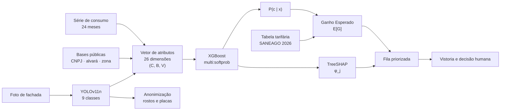
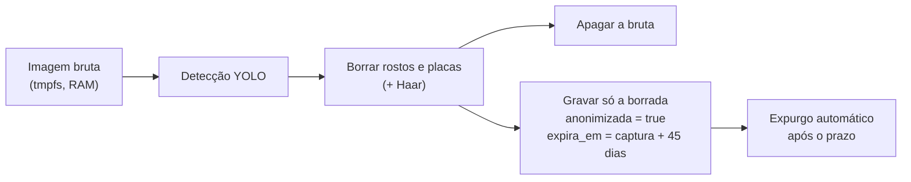

# 02 — Metodologia de IA e Data Mining

**Radar Cadastral SANEAGO** · SENAI FATESG · Inteligência Artificial · 3º período · 2/2026

> **Escopo.** Descrição formal do pipeline de Visão Computacional (YOLOv11, classes-alvo,
> pré-processamento e anonimização LGPD), da engenharia de atributos, da formulação do
> **Ganho Esperado**, do modelo de classificação e ranqueamento, da linha de base e das
> técnicas de explicabilidade (XAI). Os números citados vêm de
> `experiments/resultados/benchmark.json` (semente 20261125). O protocolo que os gerou está
> em [04](04_PROTOCOLO_EXPERIMENTAL_E_METRICAS.md).

---

## Sumário

1. [Formulação do problema](#1-formulação-do-problema)
2. [Dados e geração sintética](#2-dados-e-geração-sintética)
3. [Pipeline de Visão Computacional](#3-pipeline-de-visão-computacional)
4. [Anonimização LGPD](#4-anonimização-lgpd)
5. [Engenharia de atributos](#5-engenharia-de-atributos)
6. [Modelo de classificação](#6-modelo-de-classificação)
7. [Estrutura tarifária e Ganho Esperado](#7-estrutura-tarifária-e-ganho-esperado)
8. [Ranqueamento da fila](#8-ranqueamento-da-fila)
9. [Linha de base por regras](#9-linha-de-base-por-regras)
10. [Explicabilidade (XAI)](#10-explicabilidade-xai)
11. [Módulo Tarifa Social: vínculo e elegibilidade](#11-módulo-tarifa-social-vínculo-e-elegibilidade)
12. [Relação com as técnicas de Data Mining](#12-relação-com-as-técnicas-de-data-mining)
13. [Ameaças à validade da metodologia](#13-ameaças-à-validade-da-metodologia)

---

## 1. Formulação do problema

Seja $\mathcal{U}$ o conjunto de UCs atualmente cadastradas em categoria residencial
($c_0 \in \{\text{Residencial Normal}, \text{Residencial Social}\}$). Para cada UC $u$
observa-se um vetor de atributos $\mathbf{x}_u \in \mathbb{R}^{26}$ e deseja-se estimar a
distribuição da **categoria real de uso**

$$
P(c \mid \mathbf{x}_u), \qquad c \in \mathcal{C} = \{\text{RESIDENCIAL}, \text{COMERCIAL\_I}, \text{COMERCIAL\_II}, \text{INDUSTRIAL}\}.
$$

A tarefa de mineração é **classificação multiclasse**, mas a saída operacional é um
**ranqueamento**: a fila de vistoria ordena $\mathcal{U}$ pelo ganho esperado de receita, e
apenas os primeiros $k$ são visitados. A decisão final é sempre humana (Regra de Ouro).

Rótulo binário usado na avaliação:

$$
y_u = \mathbb{1}\big[c^{\text{real}}_u \in \{\text{COMERCIAL\_I}, \text{COMERCIAL\_II}, \text{INDUSTRIAL}\}\big].
$$

**Figura 1.** Pipeline de inferência por UC.

## 2. Dados e geração sintética

Como o projeto ainda não tem acesso aos dados da concessionária, todos os experimentos usam um
**mundo sintético** gerado pelos mesmos geradores do *seed* do banco (`db/seed`) e reproduzido
em memória por `experiments/radar_exp/mundo.py`. Isso garante que o contrato de evidência dos
experimentos seja idêntico ao que o coletor monta em produção.

### 2.1 Território

Quinze bairros de Goiânia em quatro **estratos de renda** (ALTA, MÉDIA-ALTA, MÉDIA, BAIXA),
com centroides **aproximados** e renda média per capita **ilustrativa** (a substituir pelos
setores censitários do IBGE, Censo 2022). O estrato é a variável de grupo do indicador de
equidade I5.

### 2.2 Cenários

Cada UC procedural recebe um **cenário**, sorteado com probabilidades que dependem do estrato
(`PROB_CENARIO_POR_ESTRATO`). Os cenários incluem **armadilhas** deliberadas, para que nenhum
grupo de atributos separe as classes sozinho:

| Cenário | Cadastro → Real | Consumo | Sinais visuais | Armadilha |
|---|---|---|---|---|
| `RES_OK` | Res. Normal → Res. Normal | estável 9–16 m³ | (distrator raro) | — |
| `CONSUMO_ALTO_RES` | Res. Normal → Res. Normal | estável 22–32 m³ | (distrator raro) | falso positivo por consumo |
| `RES_COM_I` | Res. Normal → **Comercial I** | degrau 10–14 → 24–45 m³ | letreiro, placa | — |
| `RES_COM_II` | Res. Normal → **Comercial II** | degrau 6–8 → 8,5–9,8 m³ (teto 10) | placa, banner | ganho baixo |
| `RES_IND` | Res. Normal → **Industrial** | degrau 12–16 → 65–95 m³ | portão industrial, doca | — |
| `COM_INFORMAL` | Res. Normal → **Comercial I** | degrau 10–13 → 17–24 m³ | placa | falso negativo de CNPJ (sem CNPJ) |
| `HOME_SERVICE` | Res. Normal → Res. Normal | degrau leve 10–12 → 12–14 m³ | banner pequeno | falso positivo visual |
| `MEI_SEM_ATIVIDADE` | Res. Normal → Res. Normal | estável 9–13 m³ | (distrator) | falso positivo de CNPJ |
| `IMAGEM_DESATUALIZADA` | Res. Normal → Res. Normal | estável | sem foto | ausência de imagem |
| `SOCIAL_ELEGIVEL` | Res. Normal → Res. Social | estável 6–10 m³ | — | (rótulo da Tarifa Social) |
| `COM_OK`, `COM_II_OK`, `IND_OK`, `SOCIAL_OK` | cadastro correto | — | — | — |

Ruídos adicionados para realismo:

* **sazonalidade** de Goiânia, $s(m) = 1 + 0{,}08\cos\!\big(2\pi(m-9)/12\big)$ (pico na estiagem);
* ruído gaussiano por leitura e **rampa** de 2 meses na abertura do negócio;
* 5% de **leituras estimadas** (média das 3 anteriores);
* **oclusão** dos elementos comerciais (probabilidade de visibilidade 0,8; 0,6 no comércio
  informal; 0,7 no Comercial II);
* **distratores** visuais em residências regulares (placa ou banner em 3–10% dos casos);
* CNPJ **baixado** de negócio antigo em 4% das residências;
* 4% das UCs sem foto em nenhuma fonte e 6% com foto antiga (> 18 meses).

A prevalência resultante de irregulares entre as residenciais foi de **13,2%** no conjunto de
desenvolvimento $W$ e **11,9%** no conjunto de teste $T$.

## 3. Pipeline de Visão Computacional

### 3.1 Arquitetura

**YOLOv11n** (Ultralytics), detector de estágio único, sem âncoras, com *backbone* C3k2,
bloco SPPF e atenção espacial C2PSA, e cabeça de detecção desacoplada. A variante *nano*
(≈ 2,6 M parâmetros) foi escolhida para viabilizar treino e inferência em CPU.

### 3.2 Classes-alvo

| Índice | Classe | Categoria que sugere | Peso *a priori* (catálogo) |
|---|---|---|---|
| 0 | `placa_comercial` | Comercial I | 0,70 |
| 1 | `letreiro` | Comercial I | 0,80 |
| 2 | `vitrine` | Comercial I | 0,75 |
| 3 | `banner` | Comercial II | 0,45 |
| 4 | `portao_industrial` | Industrial | 0,65 |
| 5 | `doca_carga` | Industrial | 0,80 |
| 6 | `estacionamento_clientes` | Comercial I | 0,50 |
| 7 | `rosto` | — (privacidade) | — |
| 8 | `placa_veiculo` | — (privacidade) | — |

As classes 7 e 8 existem **apenas** para a anonimização: nunca entram no vetor de atributos.
O pesos *a priori* ficam em `analise.classe_visual` para documentação; o modelo aprende os
pesos efetivos a partir dos dados.

### 3.3 Treino (*fine-tuning*)

**Tabela 1.** Treino do detector (`experiments/treinar_yolo.py`).

| Hiperparâmetro | Valor |
|---|---|
| Pesos iniciais | `yolo11n.pt` (pré-treinado no COCO) |
| Conjunto | sintético anotado: 600 treino / 150 validação |
| Composição | 25% fachadas só residenciais; demais com cada elemento comercial sorteado com prob. 0,28 (mínimo 1); pessoa e carro com prob. 0,5 |
| Épocas | 12 |
| Resolução de entrada (`imgsz`) | 416 px |
| Lote | 16 |
| Dispositivo | CPU, 1 *worker* de dados |
| Semente | 20261125 |
| Tempo de treino | 1.471,8 s |

**Tabela 2.** Desempenho do detector na validação sintética.

| Métrica | Valor |
|---|---|
| mAP@0,5 | 0,996 |
| mAP@0,5:0,95 | 0,940 |
| Precisão média | 0,995 |
| Recall médio | 0,983 |
| mAP@0,5:0,95 — `rosto` | 0,896 |
| mAP@0,5:0,95 — `placa_veiculo` | 0,951 |
| mAP@0,5:0,95 — `estacionamento_clientes` (pior classe) | 0,888 |
| Tempo de inferência | **40,8 ms/imagem** (CPU, 1 processo) |

O valor quase perfeito reflete o **domínio sintético** (fundos e elementos gerados por
programa), não o desempenho esperado em fotos reais (seção 13).

### 3.4 Pré-processamento e inferência

1. A imagem é lida da quarentena (RAM) em BGR.
2. Redimensionamento com *letterbox* para 416 px (Ultralytics).
3. Inferência com limiar mínimo $\min(\tau_c, \tau_p)$ e filtro por classe:
   $\tau_c = 0{,}35$ para classes comerciais (`YOLO_CONF_MIN`) e $\tau_p = 0{,}15$ para rosto
   e placa (`YOLO_CONF_PRIVACIDADE`). O limiar de privacidade é baixo de propósito:
   **na anonimização, um falso negativo custa mais que um falso positivo**.
4. As caixas são normalizadas para $[0,1]$ e gravadas em `analise.deteccao_visual`
   (exibidas no frontend como *bounding boxes*).

## 4. Anonimização LGPD

Para cada caixa $b = (x_1,y_1,x_2,y_2)$ das classes `rosto` ou `placa_veiculo`:

1. **Margem** de 15% em cada eixo: $b' = (x_1 - 0{,}15w_b,\ y_1 - 0{,}15h_b,\ x_2 + 0{,}15w_b,\ y_2 + 0{,}15h_b)$, recortada à imagem.
2. **Pixelização:** reduz a região para $1/10$ da resolução e amplia de volta por vizinho mais próximo.
3. **Desfoque gaussiano** com $\sigma = \max(3,\ w_{b'}/8)$.

A composição pixelização + desfoque é **irreversível** na prática (a informação de alta
frequência é descartada antes do desfoque). Como segunda camada, um detector **Haar** de rostos
frontais (OpenCV, `scaleFactor = 1,1`, `minNeighbors = 6`, `minSize = 24 px`) borra rostos
não detectados pelo YOLO, o que cobre fotos reais fora do domínio de treino. Rostos já tratados
pelo YOLO não são recontados (critério: centro da caixa Haar dentro de uma caixa YOLO).

Ordem garantida pelo código e pelo banco:

**Figura 2.** A imagem bruta nunca toca o disco; o banco rejeita registro não anonimizado (G3).

## 5. Engenharia de atributos

O contrato único está em `services/comum/radar_comum/features.py`. Seja a série mensal
$\mathbf{s} = (s_1, \dots, s_T)$, com $T = 24$, do mais antigo para o mais recente, e
$\bar{s}_{a:b}$ a média de $s_a,\dots,s_b$.

### 5.1 Grupo C — consumo (7 atributos)

| Atributo | Definição |
|---|---|
| `c_volume_ref` | $\bar v = \bar{s}_{T-5:T}$ (média dos últimos 6 meses: o regime **atual**) |
| `c_volume_inicial` | $\bar{s}_{1:6}$ |
| `c_razao_regime` | $\bar v \,/\, \max(\bar{s}_{1:6},\ 1)$ |
| `c_salto_max` | $\max_{t} \big(\bar{s}_{t:t+2} - \bar{s}_{t-3:t-1}\big)$, maior salto entre médias trimestrais consecutivas |
| `c_cv_12m` | $\sigma / \mu$ dos últimos 12 meses |
| `c_tendencia_12m` | inclinação de mínimos quadrados dos últimos 12 meses (m³/mês) |
| `c_frac_estimadas` | fração de leituras estimadas |

O desenho privilegia **mudança de regime** em vez de nível absoluto: o nível alto sozinho é a
armadilha `CONSUMO_ALTO_RES`.

### 5.2 Grupo B — bases públicas (9 atributos binários)

Pareamento UC × estabelecimento: candidato a até 50 m **e** (endereço normalizado da UC
contido no do estabelecimento **ou** `word_similarity` ≥ 0,8 a até 15 m). Isso evita atribuir
à UC o CNPJ do vizinho.

| Atributo | Definição |
|---|---|
| `b_cnpj_ativo_nao_mei` | existe CNPJ **ativo** de porte ME, EPP ou demais |
| `b_cnpj_ativo_mei` | existe MEI ativo (sinal fraco: muitos MEIs não atendem no local) |
| `b_cnpj_inativo` | existe CNPJ baixado, inapto, suspenso ou nulo |
| `b_cnae_alimentacao_veiculos` | CNAE ativo nas divisões 10, 11, 45, 47, 56 ou 96 (uso intenso de água) |
| `b_alvara_vigente` / `b_alvara_vencido` | alvará de funcionamento vigente / vencido |
| `b_zona_misto` / `b_zona_comercial` / `b_zona_industrial` | uso da zona que contém o ponto |

O CadÚnico **não** é atributo do modelo. Essa é uma restrição de finalidade (LGPD) e também de
equidade: renda não pode ser usada para decidir quem é fiscalizado.

### 5.3 Grupo V — visão computacional (10 atributos)

| Atributo | Definição |
|---|---|
| `v_imagem_disponivel` | há foto em alguma fonte |
| `v_imagem_desatualizada` | sem foto ou foto com mais de 540 dias |
| `v_n_deteccoes` | número de detecções comerciais acima de $\tau_c$ |
| `v_<classe>` (7) | $\max$ da confiança do detector para a classe (0 se ausente) |

O par disponibilidade/desatualização permite ao modelo distinguir "nada foi visto" de "não
havia o que ver". UCs sem imagem recente são sinalizadas para **atualização em campo**.

### 5.4 Ablação por grupos

`como_lista(f, grupos)` zera os grupos ausentes, o que permite treinar e avaliar as variantes
C, CB, V e CBV com o mesmo código ([04](04_PROTOCOLO_EXPERIMENTAL_E_METRICAS.md)).

## 6. Modelo de classificação

### 6.1 Escolha do algoritmo

*Gradient boosting* de árvores (**XGBoost**), pelos motivos:

* dados **tabulares heterogêneos** (contínuos, binários, confianças), sem necessidade de
  normalização;
* interações não lineares relevantes (ex.: banner **e** salto de consumo **e** CNPJ ativo);
* **TreeSHAP exato** e rápido para a explicação por UC;
* inferência em ~1 ms por UC em CPU.

### 6.2 Objetivo e hiperparâmetros

Classificação *softmax* com perda de entropia cruzada ponderada:

$$
\mathcal{L} = -\sum_{u} w_u \sum_{c \in \mathcal{C}} \mathbb{1}[y_u = c]\, \log P(c\mid\mathbf{x}_u)
+ \sum_{m=1}^{M}\Big(\gamma L_m + \tfrac{\lambda}{2}\lVert \mathbf{w}_m\rVert^2\Big),
$$

com $M$ árvores, $L_m$ folhas e pesos de folha $\mathbf{w}_m$. O desbalanceamento é tratado
por **peso de classe amortecido**:

$$
w_u = \left(\frac{N}{K\, n_{c(u)}}\right)^{1/2},
$$

em que $N$ é o tamanho do conjunto, $K = 4$ o número de classes e $n_c$ a frequência da
classe. A raiz quadrada reduz o reforço das classes raras (Industrial) e evita superestimar
probabilidades, o que distorceria o Ganho Esperado.

**Tabela 3.** Hiperparâmetros do classificador (`classificador-v1.meta.json`).

| Parâmetro | Valor | Papel |
|---|---|---|
| `objective` | `multi:softprob` | probabilidades por classe |
| `num_class` | 4 | RESIDENCIAL, COMERCIAL_I, COMERCIAL_II, INDUSTRIAL |
| árvores ($M$) | 300 | |
| `max_depth` | 4 | interações de até 4 atributos |
| `eta` | 0,08 | taxa de aprendizado |
| `subsample` | 0,9 | amostragem de linhas por árvore |
| `colsample_bytree` | 0,9 | amostragem de colunas por árvore |
| `min_child_weight` | 2 | |
| `lambda` | 1,0 | regularização L2 |
| `tree_method` | `hist` | |
| semente | 20261125 | |
| treino | 2.000 UCs do mundo $W$ |

Os hiperparâmetros foram fixados *a priori* (valores conservadores para conjuntos pequenos) e
**não** foram otimizados no conjunto de teste. A otimização sistemática fica como trabalho
futuro (seção 13).

### 6.3 Saída

A massa de RESIDENCIAL é atribuída à categoria residencial atual da UC antes do cálculo do
ganho. A **probabilidade de irregularidade** é

$$
p_u = \sum_{c \in \mathcal{C}^+} P(c \mid \mathbf{x}_u), \qquad
\mathcal{C}^+ = \{\text{COMERCIAL\_I}, \text{COMERCIAL\_II}, \text{INDUSTRIAL}\},
$$

e a **categoria sugerida** é $\hat c_u = \arg\max_c P(c \mid \mathbf{x}_u)$. No teste fora da
amostra, $\hat c$ acertou a categoria real em **84,9%** dos irregulares.

## 7. Estrutura tarifária e Ganho Esperado

### 7.1 Tarifa

Fonte: **Resolução Conjunta AGR/ARM nº 1/2026**, Anexo Único (vigência em 01/04/2026). A
fatura mensal de água e esgoto de uma economia com volume $v$ na categoria $c$ é

$$
F_c(v) = B_c + \sum_{j} \big(a_{c,j} + e^{\text{col}}_{c,j} + e^{\text{trat}}_{c,j}\big)\cdot
\max\!\Big(0,\ \min(v, \overline{v}_{c,j}) - (\underline{v}_{c,j} - 1)\Big),
$$

em que $B_c$ é a tarifa básica, $j$ percorre as faixas progressivas
$[\underline{v}_{c,j}, \overline{v}_{c,j}]$ e $a$, $e^{\text{col}}$, $e^{\text{trat}}$ são as
tarifas por m³ de água, coleta e tratamento de esgoto. Com $E$ economias, aplica-se a regra ao
volume por economia $v/E$ e multiplica-se por $E$.

**Tabela 4.** Verificações da implementação (iguais em SQL e em Python; testadas).

| Categoria | Volume | Fatura mensal |
|---|---|---|
| Residencial Normal | 15 m³ | R$ 197,86 |
| Comercial I | 15 m³ | R$ 404,66 |
| Residencial Normal | 10 m³ | R$ 132,76 |
| Comercial II | 10 m³ | R$ 131,73 |

**Premissas do grupo** (marcadas com `premissa = true` em `regulatorio.parametro`, a validar
com a concessionária):

* Comercial II só tem faixa até 10 m³; acima disso a UC é enquadrada como Comercial I;
* na Residencial Social, o volume acima de 20 m³ é faturado pelas faixas da Residencial Normal.

### 7.2 Ganho Esperado

Seja $\bar v_u$ o volume de referência (média dos últimos 6 meses) e $c_0$ a categoria atual.
Considerando apenas a direção do subfaturamento, o **ganho esperado anual** é

$$
\boxed{\ \mathbb{E}[G_u] = M \sum_{c \in \mathcal{C}^+} P(c \mid \mathbf{x}_u)\cdot
\max\!\big(0,\ F_c(\bar v_u) - F_{c_0}(\bar v_u)\big),\qquad M = 12\ }
$$

Também se reporta o **ganho se confirmado**, $G^{\text{conf}}_u = M\big(F_{\hat c_u}(\bar v_u) - F_{c_0}(\bar v_u)\big)$.

**Exemplo.** UC residencial com $\bar v = 15$ m³ e $P(\text{Comercial I}) = 0{,}9$:
$\Delta F = 404{,}66 - 197{,}86 = 206{,}80$ por mês, logo
$\mathbb{E}[G] = 12 \times 0{,}9 \times 206{,}80 = \text{R\$ } 2.233{,}44$ por ano.

**Por que não ranquear só pela probabilidade.** Um pequeno comércio com 10 m³ que deveria
estar na Comercial II paga R$ 131,73, *menos* que os R$ 132,76 da Residencial Normal. A
probabilidade de irregularidade pode ser alta, mas o ganho é nulo; ranquear por $p$ mandaria o
fiscal a casos sem impacto financeiro. O termo $\max(0,\cdot)$ captura isso.

## 8. Ranqueamento da fila

O *score* de prioridade é

$$
\text{score}_u = \mathbb{E}[G_u] + \alpha\, p_u, \qquad \alpha = 1,
$$

isto é, o próprio ganho em reais, com um termo de desempate que ordena por probabilidade os
casos com $\mathbb{E}[G] = 0$ (como o Comercial II). Como $\alpha p_u \le 1$ real, o termo não
altera a ordem entre casos com ganho relevante.

**Justificativa.** Com capacidade de $k$ vistorias de custo aproximadamente igual, escolher o
conjunto $S$ que maximiza a receita esperada é

$$
\max_{S \subseteq \mathcal{U},\ |S| = k} \sum_{u \in S} \mathbb{E}[G_u],
$$

cuja solução ótima é tomar os $k$ maiores $\mathbb{E}[G_u]$ (problema da mochila com pesos
unitários). Há uma troca deliberada: ordenar por ganho privilegia casos de alto volume com
probabilidade intermediária, o que reduz a precisão no topo em relação a ordenar por $p$, mas
aumenta a **receita capturada**. O resultado aparece no benchmark: precisão@10% de 0,753 com
**93,6% do ganho real capturado** no teste ([04](04_PROTOCOLO_EXPERIMENTAL_E_METRICAS.md)).

## 9. Linha de base por regras

Para medir o valor do aprendizado, o artigo compara o modelo com uma **regressão logística
de pesos fixos** definida por especialista (`radar_comum/baseline.py`), que usa apenas
consumo e bases públicas:

$$
p^{\text{base}}_u = \sigma\Big(\beta_0 + \sum_j \beta_j x_{u,j}\Big), \qquad \beta_0 = -3{,}0.
$$

| Atributo $x_j$ | Peso $\beta_j$ |
|---|---|
| CNPJ ativo não MEI | 2,0 |
| MEI ativo (sem outro CNPJ) | 0,5 |
| Alvará vigente | 1,2 |
| Salto de consumo: $\min(\max(r - 1{,}3,\ 0),\ 2)$, com $r$ a razão de regime | 1,6 |
| Consumo excedente: $\max(\bar v - 20,\ 0)$ m³ | 0,03 |
| Zona não residencial | 0,5 |

Categoria provável: Industrial se $\bar v \ge 55$ m³ e (razão $> 2{,}5$ ou zona industrial);
Comercial II se $\bar v \le 10$ m³; Comercial I nos demais. A linha de base é ranqueada pelo
**mesmo** $\mathbb{E}[G]$, de modo que a comparação isola o efeito do modelo.

## 10. Explicabilidade (XAI)

### 10.1 TreeSHAP

Para a classe explicada $c^\star = \arg\max_{c \ne \text{RES}} P(c\mid\mathbf{x})$, o
XGBoost decompõe o *logit* em contribuições aditivas exatas (Lundberg *et al.*, 2020):

$$
\operatorname{logit}_{c^\star}(\mathbf{x}) = \phi_0 + \sum_{j=1}^{26} \phi_j(\mathbf{x}),
$$

em que $\phi_j$ é o **valor de Shapley** do atributo $j$, isto é, a média ponderada da
contribuição marginal de $j$ sobre todas as coalizões de atributos:

$$
\phi_j = \sum_{S \subseteq F\setminus\{j\}} \frac{|S|!\,(|F|-|S|-1)!}{|F|!}\Big[f_{S\cup\{j\}}(\mathbf{x}_{S\cup\{j\}}) - f_S(\mathbf{x}_S)\Big].
$$

O cálculo usa `pred_contribs=True` do próprio XGBoost (TreeSHAP exato, tempo polinomial na
profundidade), sem biblioteca adicional.

### 10.2 Apresentação ao usuário

A explicação gravada em `resultado_analise.explicabilidade` contém:

* os até 8 fatores de maior $|\phi_j|$, com descrição em linguagem natural, valor observado e
  contribuição em *log-odds*;
* resumo "a favor" (3 maiores $\phi_j > 0$) e "contra" (2 maiores $\phi_j < 0$);
* aviso fixo: *"Recomendação para vistoria. A decisão sobre a categoria é sempre humana."*

No frontend, os fatores aparecem como barras divergentes (laranja aumenta, azul diminui), junto
da fachada com as caixas detectadas, das evidências das bases públicas, da comparação
tarifária e da série de consumo. Esse conjunto permite ao analista **contestar** a
recomendação, e não apenas aceitá-la.

### 10.3 Importância global

Ganho médio por atributo no modelo final (XGBoost `gain`), os oito primeiros:

| Atributo | Ganho |
|---|---|
| `v_doca_carga` | 43,2 |
| `v_portao_industrial` | 40,9 |
| `b_cnpj_ativo_mei` | 18,3 |
| `v_n_deteccoes` | 17,8 |
| `b_cnpj_ativo_nao_mei` | 9,9 |
| `c_volume_ref` | 8,9 |
| `v_letreiro` | 3,6 |
| `c_volume_inicial` | 3,6 |

Os atributos visuais industriais lideram porque separam a classe Industrial quase sozinhos.
O MEI aparece alto como sinal **negativo** (armadilha `MEI_SEM_ATIVIDADE`): o modelo aprendeu
que MEI sem outros sinais não indica uso comercial. A importância por ganho mede o uso do
atributo nas divisões, não o efeito causal, e por isso o artigo deve apresentá-la junto da
ablação.

## 11. Módulo Tarifa Social: vínculo e elegibilidade

Executado **somente** com o papel `radar_social`; o resultado nunca alimenta o modelo de
fiscalização.

**Vínculo família → UC** (*record linkage*). Para cada família do CadÚnico, candidatos são as
UCs ativas a até $R = 150$ m. Para cada candidato,

$$
\text{conf} = 0{,}6\cdot \text{sim}_{\text{trigram}}(\text{end}_f,\ \text{end}_u) + 0{,}4\cdot\Big(1 - \frac{d(f,u)}{R}\Big),
$$

e escolhe-se o candidato de maior confiança. Método: `ENDERECO_EXATO` (sim = 1),
`ENDERECO_SIMILAR` (sim ≥ 0,45) ou `PROXIMIDADE_GEO`.

**Elegibilidade** (Lei 14.898/2024): renda per capita $\le \tfrac12$ salário mínimo
(R$ 810,50 com o SM de 2026, R$ 1.621,00) **ou** recebimento de BPC.

**Alerta**: família elegível, vínculo com confiança ≥ 0,5, UC ativa fora da Residencial
Social e sem alerta aberto. Cada alerta guarda a regra aplicada, a renda, o limite e o vínculo
(`evidencia` em JSONB), e a inclusão só acontece após confirmação da assistência social.

## 12. Relação com as técnicas de Data Mining

| Técnica (PI, seção 7.5) | Onde aparece |
|---|---|
| **Classificação** | XGBoost multiclasse (seção 6) e regra de elegibilidade da Tarifa Social (seção 11) |
| **Detecção de anomalias** | Atributos de mudança de regime de consumo: razão, salto máximo, tendência, variabilidade (seção 5.1) |
| **Regras de associação** | Interações de até 4 atributos nas árvores, explicitadas por UC no TreeSHAP; a linha de base codifica as regras de especialista (seção 9) |
| **Agrupamento espacial** | Concentração territorial auditada por faixa de renda no I5 e na paridade de seleção ([03](03_ETICA_EQUIDADE_E_MODEL_CARD.md)) |
| **Record linkage** | Vínculo CadÚnico × UC por similaridade de trigramas e distância (seção 11) |

O processo segue o **CRISP-DM**: entendimento do negócio (Entrega 04 e tarifas), entendimento e
preparação dos dados (`seed`, `mundo.py`, `features.py`), modelagem (seções 6–9), avaliação
([04](04_PROTOCOLO_EXPERIMENTAL_E_METRICAS.md)) e implantação (worker de IA,
[05](05_MANUAL_IMPLANTACAO_E_OPERACAO.md)).

## 13. Ameaças à validade da metodologia

* **Domínio sintético.** Fachadas, séries e cenários são gerados. As métricas medem a
  capacidade do *pipeline* de recuperar o sinal plantado, não o desempenho em campo. O mAP de
  0,996 não deve ser comparado a *benchmarks* de fotos reais.
* **Mudança de domínio na visão.** Fotos de leituristas têm iluminação, ângulo e resolução
  variáveis; será necessário rotular uma amostra real e refazer o *fine-tuning*.
* **Hiperparâmetros não otimizados.** Fixados *a priori*; uma busca com validação aninhada
  pode melhorar o modelo e deve ser feita só em $W$.
* **Rótulos do mundo real.** Em produção, o rótulo vem do laudo, que só existe para UCs
  vistoriadas (viés de seleção). Por isso o protocolo exige amostra aleatória (I4).
* **Premissas tarifárias.** O enquadramento do Comercial II acima de 10 m³ e o transbordo da
  Residencial Social são premissas a confirmar no Regulamento da SANEAGO.
* **Licença do detector.** O Ultralytics YOLO é distribuído sob **AGPL-3.0**; o uso comercial
  em serviço de rede exige abrir o código ou obter licença comercial da Ultralytics. Isso é
  compatível com a estratégia híbrida da Entrega 04, mas precisa entrar na análise jurídica.

## Referências

* AGÊNCIA GOIANA DE REGULAÇÃO (AGR); ARM. *Resolução Conjunta nº 1/2026* — estrutura tarifária SANEAGO.
* AGR. *Relatório de Análise de Impacto Regulatório nº 17/2026* — Tarifa Social.
* BRASIL. *Lei nº 14.898, de 13 de junho de 2024* — Tarifa Social de Água e Esgoto.
* BRASIL. *Lei nº 13.709, de 14 de agosto de 2018* — Lei Geral de Proteção de Dados Pessoais.
* CHEN, T.; GUESTRIN, C. XGBoost: A Scalable Tree Boosting System. *KDD*, 2016.
* JOCHER, G.; QIU, J. *Ultralytics YOLO11*, 2024. Disponível em: https://github.com/ultralytics/ultralytics.
* LUNDBERG, S. M. *et al.* From local explanations to global understanding with explainable AI for trees. *Nature Machine Intelligence*, 2(1), 2020.
* LUNDBERG, S. M.; LEE, S.-I. A Unified Approach to Interpreting Model Predictions. *NeurIPS*, 2017.
* VIOLA, P.; JONES, M. Rapid object detection using a boosted cascade of simple features. *CVPR*, 2001.
* WIRTH, R.; HIPP, J. CRISP-DM: Towards a standard process model for data mining. 2000.
