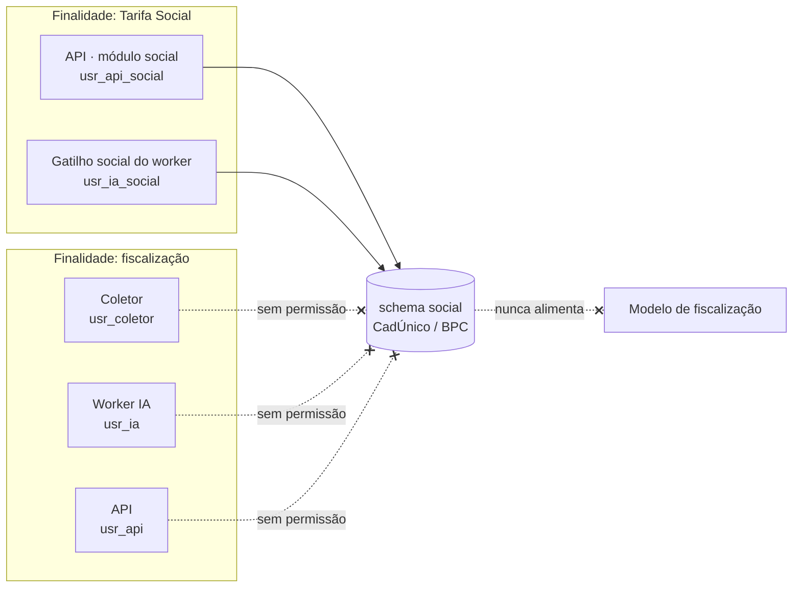
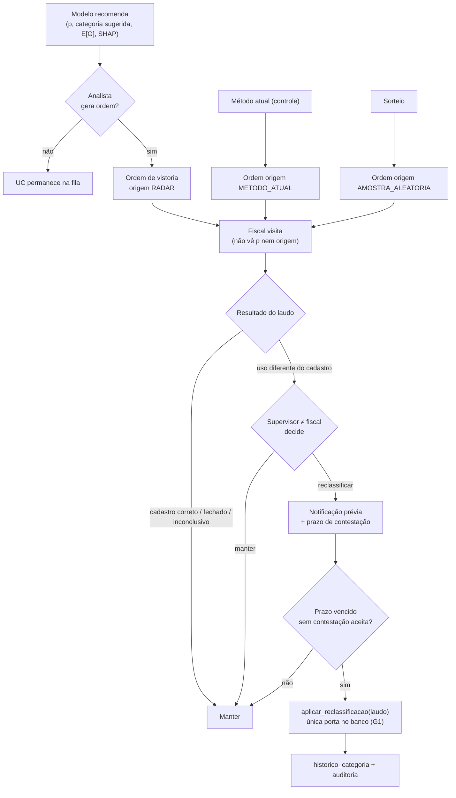

# 03 — Ética, Equidade e *Model Card*

**Radar Cadastral SANEAGO** · SENAI FATESG · Inteligência Artificial · 3º período · 2/2026

> **Escopo.** Ficha técnica do modelo (*Model Card*), governança de dados (LGPD, restrições
> do Street View e do CadÚnico), supervisão humana (*Human-in-the-Loop*), formulação matemática
> dos indicadores de impacto sociotécnico **I1 a I5** e auditoria de viés territorial com os
> resultados do benchmark. Formulação do modelo em [02](02_METODOLOGIA_IA_E_DATA_MINING.md);
> protocolo e métricas em [04](04_PROTOCOLO_EXPERIMENTAL_E_METRICAS.md).

---

## Sumário

1. [Princípios](#1-princípios)
2. [Model Card](#2-model-card)
3. [Governança de dados](#3-governança-de-dados)
4. [Supervisão humana (Human-in-the-Loop)](#4-supervisão-humana-human-in-the-loop)
5. [Indicadores de impacto sociotécnico I1–I5](#5-indicadores-de-impacto-sociotécnico-i1i5)
6. [Auditoria de viés territorial](#6-auditoria-de-viés-territorial)
7. [Riscos e mitigação](#7-riscos-e-mitigação)
8. [Alinhamento com os ODS](#8-alinhamento-com-os-ods)

---

## 1. Princípios

| Princípio (PI, seção 7.3) | Como o sistema cumpre | Onde verificar |
|---|---|---|
| **Supervisão humana** | A IA nunca altera categoria; o banco rejeita qualquer mudança fora do fluxo de laudo aprovado | G1 em `db/init/03_inclusao_tarifa_social.sql`; seção 4 |
| **Transparência e explicabilidade** | Cada recomendação traz fatores TreeSHAP, evidências e imagem com detecções | `resultado_analise.explicabilidade`; tela da fila |
| **Não discriminação** | Renda e CadÚnico não são atributos do modelo; I5 e paridade de seleção auditam a fila | seção 6 |
| **Privacidade** | Imagem bruta só em RAM; rostos e placas borrados antes de gravar; expurgo em 45 dias | G3; [02 §4](02_METODOLOGIA_IA_E_DATA_MINING.md#4-anonimização-lgpd) |
| **Finalidade** | CadÚnico só para incluir na Tarifa Social, nunca para fiscalizar | G2; papel `radar_social` |
| **Contestabilidade** | Notificação prévia e prazo de contestação antes de aplicar a reclassificação | `laudo_vistoria.prazo_contestacao_ate` |
| **Prestação de contas** | Trilha de auditoria imutável com autor e horário | G5; tela de auditoria |

## 2. Model Card

Formato baseado em Mitchell *et al.* (2019).

### 2.1 Detalhes do modelo

| Campo | Valor |
|---|---|
| Nome / versão | `xgb-cbv-v1` (classificador) + `yolo11n-fachada` (detector) |
| Responsáveis | Equipe do Projeto Integrador, SENAI FATESG (2/2026) |
| Tipo | Detector de objetos (YOLOv11n) + *gradient boosting* multiclasse (XGBoost 3.4) |
| Entrada | 26 atributos: consumo (7), bases públicas (9), visão computacional (10) |
| Saída | $P(c \mid \mathbf{x})$ para RESIDENCIAL, COMERCIAL_I, COMERCIAL_II, INDUSTRIAL; categoria sugerida; $\mathbb{E}[G]$; explicação TreeSHAP |
| Treino | 2.000 UCs sintéticas (mundo $W$), semente 20261125, peso de classe amortecido |
| Licenças | Código do projeto: a definir pela equipe. Ultralytics YOLO: **AGPL-3.0** |
| Artefatos | `services/ai_worker/modelos/` (`classificador-v1.json`, `.meta.json`, `yolo11n-fachada.pt`, métricas) |

### 2.2 Uso pretendido

* **Uso primário:** priorizar a fila de vistoria de imóveis cadastrados como residenciais com
  indícios de uso comercial ou industrial, ordenada pelo ganho esperado de receita.
* **Usuários:** analistas comerciais e supervisores da concessionária; fiscais de campo
  recebem a ordem **sem** a probabilidade (laudo cego).
* **Fora do escopo (usos proibidos):**
  * alterar a categoria tarifária sem vistoria e decisão humana;
  * aplicar multa, cobrança retroativa ou sanção com base apenas no *score*;
  * usar imagens do Google Street View para inferência automatizada;
  * usar dados do CadÚnico, renda ou faixa de renda do bairro como atributo de fiscalização;
  * identificar pessoas a partir das imagens.

### 2.3 Fatores relevantes

* **Faixa de renda do bairro** (ALTA, MÉDIA-ALTA, MÉDIA, BAIXA): grupo de auditoria do I5.
* **Tipo de cenário**: comércio informal sem CNPJ, serviço em casa, MEI sem atividade e consumo
  alto residencial são os casos difíceis (armadilhas).
* **Disponibilidade e idade da imagem**: sem foto recente, o modelo depende de consumo e
  bases públicas.

### 2.4 Métricas e resultados

Avaliação em teste fora da amostra ($T$, 1.000 UCs, 967 residenciais, 119 irregulares),
$k = 10\%$ = 97 UCs, IC 95% por *bootstrap* estratificado ($B = 1000$).

| Métrica | Modelo proposto (CBV) | Linha de base por regras |
|---|---|---|
| Precisão@10% | **0,753** [0,639; 0,856] | 0,557 [0,454; 0,639] |
| Recall@10% | 0,613 | 0,454 |
| Ganho capturado@10% | **0,936** [0,886; 0,977] | 0,754 [0,664; 0,821] |
| ROC-AUC | 0,982 [0,968; 0,992] | 0,802 [0,751; 0,853] |
| AUC-PR | 0,933 [0,902; 0,961] | 0,643 [0,567; 0,717] |
| F1 (limiar 0,5) | 0,872 | 0,509 |
| Brier | 0,026 | 0,068 |
| Acerto da categoria sugerida (irregulares) | 0,849 | — |
| Detector: mAP@0,5 / mAP@0,5:0,95 | 0,996 / 0,940 | — |

### 2.5 Dados de avaliação e de treino

Dados **sintéticos** gerados com os mesmos geradores do *seed* (cenários, ruídos e
distratores descritos em [02 §2](02_METODOLOGIA_IA_E_DATA_MINING.md#2-dados-e-geração-sintética)).
Nenhum dado pessoal real foi usado.

### 2.6 Análise de equidade (resumo)

O modelo **não** passou no critério do I5 no teste sintético: a razão de FDR entre faixas no
topo da fila foi **1,90** (limite 1,25), e o recall na faixa BAIXA foi o menor (0,758). O
resultado está detalhado e discutido na seção 6. Pela regra do próprio projeto, ele **dispara
revisão do modelo antes de qualquer piloto**.

### 2.7 Considerações éticas e limitações

* Métricas medidas em domínio sintético; o desempenho real só será conhecido no piloto com grupo
  controle e amostra aleatória.
* O detector foi treinado em fachadas geradas por programa; fotos reais exigirão novo rótulo e
  *fine-tuning*.
* O sistema pode **concentrar vistorias** em bairros com mais comércio informal; o I5 e a
  paridade de seleção existem para detectar isso.
* Trabalhadores autônomos em casa (manicure, costureira) nem sempre mudam de categoria pelas
  regras da concessionária; o laudo humano decide.
* A reclassificação pode dobrar a conta de um pequeno negócio; o fluxo exige notificação prévia
  e prazo de contestação.

## 3. Governança de dados

### 3.1 Bases de dados, base legal e finalidade

| Base | Dados | Finalidade | Base legal (LGPD) | Controles |
|---|---|---|---|---|
| Cadastro e consumo da concessionária | UC, endereço, categoria, consumo | Fiscalização e faturamento | Art. 7º, V (execução de contrato) e VI (exercício regular de direito); art. 23 (poder público, quando aplicável) | Titular pseudonimizado (`SHA-256` com sal) |
| CNPJ (Receita Federal) | Estabelecimento, CNAE, porte, situação | Indício de atividade econômica | Dado público (art. 7º, §3º e §4º) | Pareamento por endereço e distância |
| Alvarás e zoneamento (Prefeitura) | Atividade autorizada, uso da zona | Indício de atividade econômica | Dado público; acordo de cooperação | — |
| Fotos de fachada (leituristas, Mapillary, Geo360) | Imagem da fachada | Indício visual de uso | Legítimo interesse (art. 7º, IX), com teste de balanceamento | Anonimização antes de gravar; retenção de 45 dias; sem Street View |
| CadÚnico / BPC | Renda per capita, BPC, endereço | **Somente** inclusão na Tarifa Social | Execução de política pública (art. 7º, III; art. 23); Lei 14.898/2024 | Schema `social` isolado; papel `radar_social`; código familiar em *hash* |

### 3.2 Restrição do Google Street View

Os termos do Google Maps Platform proíbem usar o conteúdo para treinar ou validar modelos de IA
e vedam análise de imagem e detecção de objetos sobre ele. A restrição foi implementada em três
camadas:

1. **Banco:** o tipo `analise.fonte_imagem` não tem valor para Street View (G4); é impossível
   gravar uma imagem com essa origem.
2. **Coletor:** a fonte `streetview` é rejeitada na configuração (`montar_fontes`).
3. **Frontend:** o Street View aparece só como **link externo** para consulta humana, com o
   aviso "essas imagens não entram na análise automática".

As fontes de inferência são as **fotos dos leituristas** (que já visitam todos os imóveis todo
mês), **Mapillary** (licença CC BY-SA) e o portal **Geo360 Goiânia** por acordo com a Prefeitura.

### 3.3 Restrição do CadÚnico

**Figura 1.** Isolamento de finalidade. O papel `radar_social` não herda `radar_base`, e os
papéis de fiscalização não têm `USAGE` no schema `social` (G2).

O indicador I3 é exposto aos gestores **apenas como contagem agregada**, calculada pela conexão
social; nenhum dado individual do CadÚnico sai do módulo.

### 3.4 Ciclo de vida da imagem

| Etapa | Onde | Duração |
|---|---|---|
| Captura pela fonte | Fonte externa | — |
| Imagem bruta | *tmpfs* `quarentena_imagens` (RAM) | segundos (apagada após a anonimização ou na falha) |
| Imagem anonimizada | volume `storage_imagens` + `analise.imagem_fachada` | até `expira_em` = captura + 45 dias |
| Expurgo | laço do worker de IA | automático; a API passa a responder `410 Gone` |

### 3.5 Direitos do titular

O titular da UC pode contestar a reclassificação no prazo definido pelo supervisor
(`prazo_contestacao_ate`). O laudo, a decisão e a explicação do modelo ficam registrados e podem
ser apresentados ao titular, o que atende ao direito de revisão de decisões automatizadas
(LGPD, art. 20). Aqui a decisão **não** é automatizada, mas a explicação continua disponível.

## 4. Supervisão humana (Human-in-the-Loop)

**Figura 2.** Fluxo de decisão. Os três pontos de controle humano são: o analista (gera a
ordem), o fiscal (constata em campo) e o supervisor (decide e aplica), com segregação de
funções entre fiscal e supervisor garantida por `CHECK` no banco.

Elementos de desenho que reduzem a **automação de confiança** (*automation bias*):

* **Laudo cego:** o fiscal não vê a probabilidade, o ganho nem a origem da ordem; registra o que
  encontrou.
* **Grupo controle e amostra aleatória:** ordens do método atual e sorteadas entram na mesma
  fila do fiscal, indistinguíveis das do Radar. Isso permite medir I1 e I4 sem viés.
* **Explicação contestável:** o analista vê fatores a favor e contra, e as evidências brutas.
* **Duas portas, ambas humanas:** reclassificação (supervisor) e inclusão na Tarifa Social
  (assistente social). Não existe terceira porta.

## 5. Indicadores de impacto sociotécnico I1–I5

Os indicadores vêm da Entrega 04 e são calculados **dinamicamente** pela API
(`services/api/app/servicos/indicadores.py`) a partir dos registros do próprio sistema. Para
proporções, usa-se o **intervalo de Wilson** a 95%, adequado a amostras pequenas e proporções
próximas de 0 ou 1:

$$
\hat p = \frac{s}{n},\qquad
\text{IC}_{95\%} = \frac{\hat p + \dfrac{z^2}{2n} \pm z\sqrt{\dfrac{\hat p(1-\hat p)}{n} + \dfrac{z^2}{4n^2}}}{1 + \dfrac{z^2}{n}},\qquad z = 1{,}96.
$$

Uma vistoria é **conclusiva** se o resultado é `IRREGULARIDADE_CONFIRMADA` ou
`CADASTRO_CORRETO`; imóvel fechado e inconclusivo contam como realizadas, mas não entram no
denominador das taxas.

### I1 — Taxa de acerto das vistorias (econômica)

Para cada origem $g \in \{\text{RADAR}, \text{METODO\_ATUAL}, \text{AMOSTRA\_ALEATORIA}\}$:

$$
I_1^{(g)} = \frac{\#\{\text{laudos de origem } g \text{ com irregularidade confirmada}\}}{\#\{\text{laudos conclusivos de origem } g\}},
\qquad
R_1 = \frac{I_1^{(\text{RADAR})}}{I_1^{(\text{METODO\_ATUAL})}}.
$$

**Meta do piloto:** $R_1 \ge 3$ (parâmetro `i1_meta_razao_controle`).

### I2 — Receita recuperada por real investido (econômica)

Para as reclassificações aplicadas no período $\mathcal{P}$ (padrão: 12 meses), com
$\bar v_i$ a média dos 6 meses anteriores à mudança:

$$
I_2 = \frac{\displaystyle\sum_{i \in \mathcal{P}} \max\!\big(0,\ F_{\text{nova},i}(\bar v_i) - F_{\text{antiga},i}(\bar v_i)\big)\times 12}{C_{\mathcal{P}}},
\qquad
\text{ROI} = (I_2 - 1)\times 100\%.
$$

$C_{\mathcal{P}}$ é o custo registrado em `fiscalizacao.custo_solucao`; na ausência de registro,
usa-se a premissa da Entrega 04:

$$
C_{\mathcal{P}} = 0{,}15 \times N_{\text{UCs ativas}} \times \text{meses} + 40.000 \ \ (\text{implantação}).
$$

$I_2 > 1$ significa que a solução se paga. Reduções de conta (por exemplo, inclusão na Tarifa
Social) são reportadas à parte e não abatem a receita.

### I3 — Cobertura da Tarifa Social, ICTS (social)

$$
I_3 = \frac{\#\{\text{economias na categoria Residencial Social}\}}{\#\{\text{famílias elegíveis com ligação ativa}\}},
$$

com elegível = renda per capita $\le \tfrac12$ SM **ou** BPC (Lei 14.898/2024). **Meta:** 100%,
conforme o ICTS proposto pela AGR (Relatório de AIR nº 17/2026). Também se reportam famílias
vinculadas, alertas abertos e famílias incluídas pelo sistema.

### I4 — Precisão e recall do modelo (tecnológica)

Seja o ranking das UCs residenciais analisadas, $N$ o seu tamanho e $k = \lceil 0{,}10\,N\rceil$:

$$
\text{Precisão@}k = \frac{\#\{u \in \text{top-}k \text{ com laudo confirmando irregularidade}\}}{\#\{u \in \text{top-}k \text{ com laudo conclusivo posterior à análise}\}},
$$

$$
\text{Recall@}k = \frac{\#\{u \in \mathcal{A}^+ : \text{pos}(u) \le k\}}{|\mathcal{A}^+|},
$$

em que $\mathcal{A}^+$ são as UCs da **amostra aleatória** vistoriada com irregularidade
confirmada. O recall só é estimado sem viés na amostra aleatória, porque as UCs vistoriadas por
indicação do Radar foram selecionadas pelo próprio modelo. A API também reporta o recall no
limiar $p \ge 0{,}5$, o F1 operacional e a cobertura de rótulos do topo.

### I5 — Diferença de erro entre faixas de renda (ética)

Para cada faixa $g$, entre as UCs **indicadas pelo Radar** e vistoriadas com laudo conclusivo:

$$
\text{FDR}_g = \frac{\#\{\text{indicadas na faixa } g \text{ com cadastro correto}\}}{\#\{\text{indicadas na faixa } g \text{ com laudo conclusivo}\}},
\qquad
R_5 = \frac{\max_g \text{FDR}_g}{\min_g \text{FDR}_g}.
$$

**Gatilho:** $R_5 > 1{,}25$ dispara **revisão do modelo** (parâmetro `i5_limite_razao_fpr`).
Faixas com menos de 5 vistorias conclusivas não entram na razão (`amostra_minima`); se a menor
taxa for 0 e a maior positiva, a razão é infinita e também dispara revisão.

> **Nota terminológica.** A Entrega 04 chama a medida de "taxa de falsos positivos (indicados
> que não tinham irregularidade)". Pela definição usada ("entre os indicados"), o nome técnico é
> **taxa de falsas descobertas** (FDR, $\text{FP}/(\text{FP}+\text{VP})$), e não a FPR
> ($\text{FP}/(\text{FP}+\text{VN})$). A FDR é a única das duas calculável em operação, porque
> só as UCs indicadas são vistoriadas. No benchmark, onde todos os rótulos são conhecidos,
> reportam-se as duas.

**Paridade de seleção** (auditável **antes** de qualquer vistoria):

$$
\text{taxa}_g = \frac{\#\{u \in \text{top-}k \text{ na faixa } g\}}{\#\{u \text{ ranqueadas na faixa } g\}}.
$$

Uma faixa com taxa muito maior que as outras indica concentração territorial da fiscalização,
mesmo que o FDR esteja equilibrado.

## 6. Auditoria de viés territorial

### 6.1 Resultado no teste fora da amostra

**Tabela 1.** Equidade por faixa de renda, modelo proposto, $T$ ($k = 97$).

| Faixa | UCs | Irregulares | FPR | TPR (recall, $p \ge 0{,}5$) | FDR no top-10% | Taxa de indicação |
|---|---|---|---|---|---|---|
| ALTA | 187 | 20 | 0,000 | 0,950 | 0,167 | 0,096 |
| MÉDIA-ALTA | 124 | 18 | 0,019 | 0,833 | 0,167 | 0,097 |
| MÉDIA | 342 | 48 | 0,014 | 0,896 | 0,317 | 0,120 |
| BAIXA | 314 | 33 | 0,025 | 0,758 | 0,231 | 0,083 |

Razões max/min: FDR@10% = **1,90**; TPR = 1,25; FPR = infinita (a faixa ALTA não teve falso
positivo no limiar 0,5).

**Tabela 2.** Mesma auditoria para a linha de base por regras.

| Faixa | FDR no top-10% | TPR | Taxa de indicação |
|---|---|---|---|
| ALTA | 0,581 | 0,700 | 0,166 |
| MÉDIA-ALTA | 0,412 | 0,444 | 0,137 |
| MÉDIA | 0,405 | 0,292 | 0,108 |
| BAIXA | 0,250 | 0,152 | 0,038 |

Razões: FDR@10% = 2,32; TPR = 4,62.

### 6.2 Discussão

1. **O modelo proposto reduz a desigualdade em relação à linha de base**, mas **não** atinge o
   limite. A razão de FDR caiu de 2,32 para 1,90, e a razão de recall caiu de 4,62 para 1,25.
2. **O erro não está concentrado na periferia no sentido temido.** A maior FDR está na faixa
   MÉDIA (0,317), não na BAIXA. O risco previsto na Entrega 04 era o sistema confundir comércio
   informal com irregularidade e lotar as periferias de vistorias inúteis; a taxa de indicação
   na BAIXA (8,3%) é a menor entre as faixas, e a FDR fica abaixo da MÉDIA.
3. **O problema na faixa BAIXA é o inverso: recall menor (0,758).** O cenário
   `COM_INFORMAL` (sem CNPJ e com placa ocluída) é mais frequente ali, e o modelo o indica
   em 66,7% dos casos, contra 97,4% no `RES_COM_I`. Em termos de justiça tarifária, isso
   significa que irregularidades em bairros ricos têm mais chance de serem encontradas. O efeito
   é o oposto da punição seletiva, mas também é desigualdade de tratamento.
4. **A linha de base é muito mais desigual.** Ela depende de CNPJ e alvará, que o comércio
   informal não tem; seu recall na faixa BAIXA é 0,152.
5. **Pela regra do projeto, o resultado dispara revisão.** Ações candidatas, a avaliar em $W$
   (nunca em $T$):
   * calibrar o limiar ou o *score* por grupo, **somente** para equalizar o recall, e não como
     atributo de decisão (pós-processamento do tipo *equalized odds*, Hardt *et al.*, 2016);
   * aumentar o peso de atributos visuais e de consumo nos casos sem CNPJ;
   * coletar fotos de leiturista mais recentes nos bairros com mais oclusão;
   * monitorar a paridade de seleção a cada ciclo antes de emitir ordens.

### 6.3 Por que não incluir a renda como atributo

Incluir a faixa de renda poderia "corrigir" o recall estatisticamente, mas faria o modelo usar a
renda do bairro para decidir quem é fiscalizado. Isso viola o princípio de não discriminação e
a finalidade do CadÚnico. A renda é usada **somente para auditar** o modelo, nunca como entrada.

## 7. Riscos e mitigação

| Risco | Probabilidade | Impacto | Mitigação implementada | Indicador |
|---|---|---|---|---|
| Viés territorial (fiscalização concentrada em periferias) | Média | Alto | Renda fora do modelo; I5; paridade de seleção | I5 |
| Punição de trabalho em casa | Média | Médio | Cenário `HOME_SERVICE` no treino; laudo humano; regras da concessionária decidem | Taxa de indicação por cenário |
| Reidentificação de pessoas nas imagens | Baixa | Alto | Anonimização antes de gravar, dupla camada (YOLO + Haar), retenção de 45 dias | Contagem de rostos/placas borrados |
| Uso indevido do CadÚnico | Baixa | Muito alto | Schema e papel isolados (G2); acesso só agregado para gestores | Testes `verificar_garantias.sh` |
| Choque na conta do pequeno negócio | Alta | Médio | Notificação prévia, prazo de contestação, aplicação só após o prazo | — |
| Automação de confiança | Média | Médio | Laudo cego; grupo controle; explicação a favor e contra | I1 por origem |
| Violação dos termos do Street View | Baixa | Alto | G4 no banco; coletor rejeita a fonte; só link no frontend | — |
| Degradação do modelo em dados reais | Alta | Alto | Piloto com controle e amostra aleatória; recalcular I4 a cada ciclo | I4 |

## 8. Alinhamento com os ODS

| ODS | Contribuição |
|---|---|
| 6 — Água potável e saneamento | Cadastro correto e Tarifa Social ampliam o acesso sustentável |
| 9 — Indústria, inovação e infraestrutura | Modernização da gestão cadastral (metas 9.1, 9.4, 9.5) |
| 10 — Redução das desigualdades | Inclusão proativa na Tarifa Social; auditoria de viés (I5) |
| 11 — Cidades sustentáveis | Gestão territorial baseada em dados; menos deslocamentos (metas 11.1, 11.3, 11.6) |
| 16 — Instituições eficazes | Transparência, explicabilidade, supervisão humana e trilha de auditoria |

## Referências

* BRASIL. *Lei nº 13.709/2018* (LGPD), arts. 6º, 7º, 20 e 23.
* BRASIL. *Lei nº 14.898/2024* — Tarifa Social de Água e Esgoto.
* AGR. *Relatório de AIR nº 17/2026* — Índice de Cobertura da Tarifa Social (ICTS).
* GOOGLE. *Google Maps Platform Terms of Service* e *Map Tiles API Policies*.
* HARDT, M.; PRICE, E.; SREBRO, N. Equality of Opportunity in Supervised Learning. *NeurIPS*, 2016.
* MITCHELL, M. *et al.* Model Cards for Model Reporting. *FAT\**, 2019.
* PARASURAMAN, R.; MANZEY, D. H. Complacency and bias in human use of automation. *Human Factors*, 52(3), 2010.
* WILSON, E. B. Probable inference, the law of succession, and statistical inference. *JASA*, 22, 1927.
