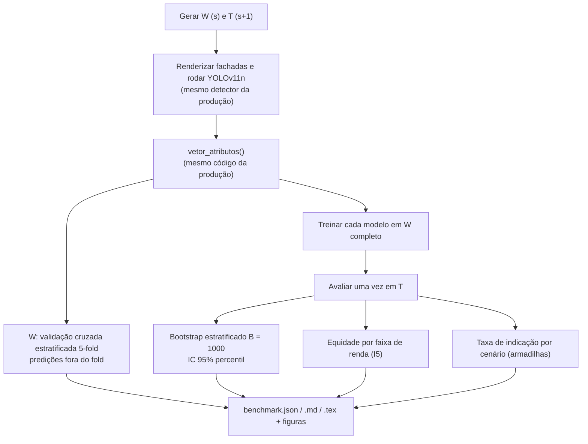
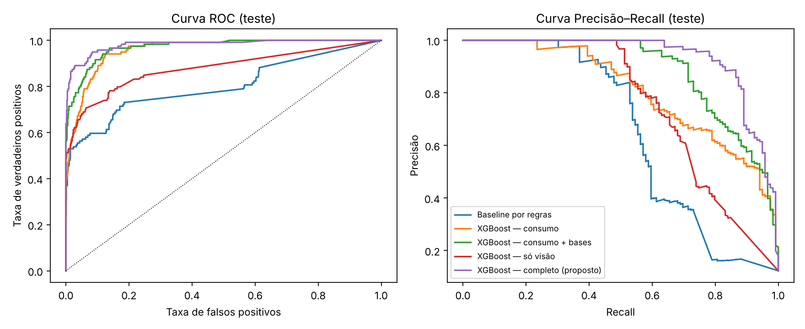
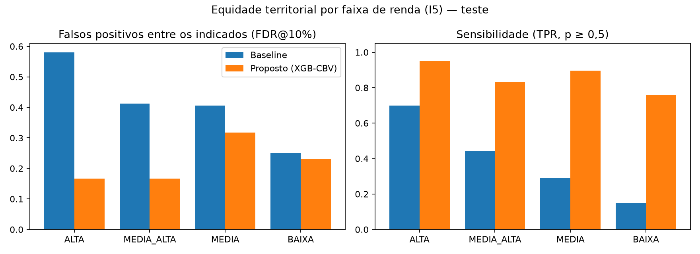

# 04 — Protocolo Experimental e Métricas

**Radar Cadastral SANEAGO** · SENAI FATESG · Inteligência Artificial · 3º período · 2/2026

> **Escopo.** Desenho experimental (teste retroativo, ablação, grupo controle e amostra
> aleatória), definição formal das métricas (Precisão@k, Recall, F1, ROI, ICTS e demais),
> resultados obtidos com os *scripts* de benchmark e *speedup*, e um **modelo de seção de
> Resultados e Discussão** pronto para o artigo. Todos os números deste documento podem ser
> regenerados pelos comandos da seção 8.

---

## Sumário

1. [Perguntas de pesquisa e hipóteses](#1-perguntas-de-pesquisa-e-hipóteses)
2. [Desenho experimental](#2-desenho-experimental)
3. [Métricas](#3-métricas)
4. [Resultados do benchmark (offline)](#4-resultados-do-benchmark-offline)
5. [Resultados de desempenho computacional](#5-resultados-de-desempenho-computacional)
6. [Protocolo do piloto em campo](#6-protocolo-do-piloto-em-campo)
7. [Ameaças à validade](#7-ameaças-à-validade)
8. [Reprodução dos resultados](#8-reprodução-dos-resultados)
9. [Modelo da seção Resultados e Discussão](#9-modelo-da-seção-resultados-e-discussão)

---

## 1. Perguntas de pesquisa e hipóteses

| Id | Pergunta | Hipótese | Teste |
|---|---|---|---|
| **PP1** | Combinar visão computacional, consumo e bases públicas melhora a priorização em relação a regras de especialista? | **H1:** Precisão@10% do modelo CBV > linha de base, com IC 95% sem sobreposição relevante | Teste fora da amostra (seção 4.2) |
| **PP2** | Qual a contribuição de cada fonte de dados? | **H2:** CBV > CB > C e CBV > V (cada fonte agrega informação) | Ablação (seção 4.3) |
| **PP3** | Ranquear por Ganho Esperado captura mais receita do que a precisão sugere? | **H3:** Ganho capturado@10% > Precisão@10% | Seção 4.2 |
| **PP4** | O modelo erra de forma desigual entre faixas de renda? | **H4 (nula, desejada):** razão de FDR entre faixas ≤ 1,25 | Auditoria I5 (seção 4.5) |
| **PP5** | O processamento distribuído escala com o número de réplicas? | **H5:** $S(p)$ cresce com $p$, com $E(p) \ge 0{,}6$ até $p = 3$ | Experimento de *speedup* (seção 5) |
| **PP6** | Em campo, o Radar acerta mais que o método atual? | **H6:** $R_1 = I_1^{\text{RADAR}} / I_1^{\text{ATUAL}} \ge 3$ | Piloto com grupo controle (seção 6) |

## 2. Desenho experimental

### 2.1 Conjuntos de dados

| Conjunto | Tamanho | Semente | Uso |
|---|---|---|---|
| $W$ (desenvolvimento) | 2.000 UCs | 20261125 | Validação cruzada estratificada (5 *folds*) e treino final |
| $T$ (teste) | 1.000 UCs | 20261126 | Avaliado **uma única vez**, com o modelo treinado em $W$ |
| Curadas | 30 UCs | — | Casos ilustrativos do artigo (posição no ranking de cada cenário) |

$W$ e $T$ são gerados com sementes diferentes pelo mesmo processo (`radar_exp/mundo.py`), o que
simula o **teste retroativo** proposto na Entrega 04: treinar com o "passado" e verificar se o
modelo teria colocado no topo os imóveis que depois se confirmaram irregulares. A população
avaliada é a das UCs atualmente **residenciais** (as que entram na fila): 967 em $T$, com 119
irregulares (prevalência 11,9%; em $W$, 13,2%).

### 2.2 Modelos comparados (ablação)

| Modelo | Atributos | Aprendizado |
|---|---|---|
| Linha de base por regras | consumo + bases (6 regras) | não (pesos fixos de especialista) |
| XGB-C | consumo (7) | XGBoost |
| XGB-CB | consumo + bases (16) | XGBoost |
| XGB-V | visão (10) | XGBoost |
| **XGB-CBV (proposto)** | todos (26) | XGBoost |

Todos usam os mesmos hiperparâmetros, a mesma semente e o mesmo **ranqueamento por
$\mathbb{E}[G]$**, de modo que a diferença entre eles é só a informação disponível.

### 2.3 Procedimento



**Figura 1.** Fluxo do `experiments/benchmark.py`.

## 3. Métricas

Notação: $y_u \in \{0,1\}$ (irregular), $p_u$ probabilidade de irregularidade, $\text{score}_u$
a prioridade ($\approx \mathbb{E}[G_u]$), $G_u$ o **ganho real** anual se a UC for irregular,
$N$ o número de UCs residenciais e $k = \lceil 0{,}10\,N \rceil$. O topo $\mathcal{T}_k$ é o
conjunto dos $k$ maiores *scores*.

### 3.1 Métricas de ranqueamento

$$
\text{P@}k = \frac{1}{k}\sum_{u \in \mathcal{T}_k} y_u,
\qquad
\text{R@}k = \frac{\sum_{u \in \mathcal{T}_k} y_u}{\sum_u y_u},
\qquad
\text{GC@}k = \frac{\sum_{u \in \mathcal{T}_k} G_u}{\sum_u G_u}.
$$

Note que $\text{R@}k \le k / \sum_u y_u$; em $T$, com $k = 97$ e 119 irregulares, o recall
máximo possível no topo é $0{,}815$.

O **ganho capturado** (GC@$k$) é a métrica de negócio: que fração da receita recuperável
total está nas primeiras $k$ vistorias.

### 3.2 Métricas de classificação (limiar $\tau = 0{,}5$)

$$
\text{Precisão} = \frac{VP}{VP+FP},\quad
\text{Recall} = \frac{VP}{VP+FN},\quad
F_1 = \frac{2\,\text{Precisão}\cdot\text{Recall}}{\text{Precisão}+\text{Recall}},
$$

$$
\text{FPR} = \frac{FP}{FP+VN},\qquad \text{FDR} = \frac{FP}{FP+VP}.
$$

### 3.3 Métricas independentes de limiar e de calibração

* **ROC-AUC:** probabilidade de uma UC irregular receber $p$ maior que uma regular.
* **AUC-PR** (precisão média): mais informativa que a ROC sob desbalanceamento.
* **Brier:** $\frac{1}{N}\sum_u (p_u - y_u)^2$, erro quadrático das probabilidades. Importa
  porque $\mathbb{E}[G]$ multiplica probabilidades por reais: um modelo mal calibrado distorce a
  fila.

### 3.4 Intervalos de confiança

*Bootstrap* percentil **estratificado** (reamostragem separada de positivos e negativos, o que
preserva a prevalência), $B = 1000$, para P@$k$, GC@$k$, ROC-AUC e AUC-PR:

$$
\text{IC}_{95\%} = \big[\hat\theta^{*}_{(2{,}5\%)},\ \hat\theta^{*}_{(97{,}5\%)}\big].
$$

Em operação, as proporções dos indicadores usam o **intervalo de Wilson**
([03 §5](03_ETICA_EQUIDADE_E_MODEL_CARD.md#5-indicadores-de-impacto-sociotécnico-i1i5)).

### 3.5 Métricas de negócio e de impacto

| Métrica | Fórmula | Definição completa |
|---|---|---|
| **I1** taxa de acerto | confirmadas / conclusivas, por origem | [03 §5](03_ETICA_EQUIDADE_E_MODEL_CARD.md#i1--taxa-de-acerto-das-vistorias-econômica) |
| **I2 / ROI** | $I_2 = \dfrac{\sum \max(0,\Delta F)\cdot 12}{C}$; $\text{ROI} = (I_2-1)\cdot 100\%$ | [03 §5](03_ETICA_EQUIDADE_E_MODEL_CARD.md#i2--receita-recuperada-por-real-investido-econômica) |
| **I3 / ICTS** | economias Residencial Social / famílias elegíveis | [03 §5](03_ETICA_EQUIDADE_E_MODEL_CARD.md#i3--cobertura-da-tarifa-social-icts-social) |
| **I4** | P@$k$ (top vistoriado) e recall (amostra aleatória) | [03 §5](03_ETICA_EQUIDADE_E_MODEL_CARD.md#i4--precisão-e-recall-do-modelo-tecnológica) |
| **I5** | $\max_g \text{FDR}_g / \min_g \text{FDR}_g \le 1{,}25$ | [03 §5](03_ETICA_EQUIDADE_E_MODEL_CARD.md#i5--diferença-de-erro-entre-faixas-de-renda-ética) |

### 3.6 Métricas de desempenho computacional

$S(p)$, $E(p)$, vazão, Karp–Flatt e Amdahl, definidas em
[01 §9.2](01_RELATORIO_TECNICO_ARQUITETURA.md#92-métricas).

## 4. Resultados do benchmark (offline)

Execução de 26/11/2026, semente 20261125, Python 3.13, XGBoost 3.4.1, CPU x86-64; tempo total
175 s (sem treino do detector). Fonte: `experiments/resultados/benchmark.{json,md}`; tabelas
LaTeX prontas em `benchmark_tabelas.tex`.

### 4.1 Validação cruzada em $W$

**Tabela 1.** Validação cruzada estratificada (5 *folds*), predições fora do *fold*.

| Modelo | P@10% | R@10% | GC@10% | ROC-AUC | AUC-PR | F1 (0,5) | Brier |
|---|---|---|---|---|---|---|---|
| Linha de base por regras | 0,648 | 0,473 | 0,731 | 0,823 | 0,683 | 0,500 | 0,073 |
| XGB-C (consumo) | 0,694 | 0,508 | 0,770 | 0,950 | 0,792 | 0,684 | 0,065 |
| XGB-CB (consumo + bases) | 0,782 | 0,572 | 0,845 | 0,969 | 0,890 | 0,794 | 0,041 |
| XGB-V (só visão) | 0,725 | 0,530 | 0,790 | 0,892 | 0,774 | 0,674 | 0,069 |
| **XGB-CBV (proposto)** | **0,855** | **0,625** | **0,910** | **0,990** | **0,956** | **0,891** | **0,024** |

### 4.2 Teste fora da amostra em $T$

**Tabela 2.** Treino em $W$, avaliação única em $T$. Entre colchetes, IC 95% por *bootstrap*.

| Modelo | P@10% | R@10% | GC@10% | ROC-AUC | AUC-PR | F1 (0,5) | Brier |
|---|---|---|---|---|---|---|---|
| Linha de base | 0,557 [0,454; 0,639] | 0,454 | 0,754 [0,664; 0,821] | 0,802 [0,751; 0,853] | 0,643 [0,567; 0,717] | 0,509 | 0,068 |
| XGB-C | 0,639 [0,536; 0,711] | 0,521 | 0,828 [0,740; 0,886] | 0,960 [0,944; 0,972] | 0,808 [0,754; 0,860] | 0,703 | 0,056 |
| XGB-CB | 0,680 [0,588; 0,773] | 0,555 | 0,865 [0,801; 0,923] | 0,972 [0,958; 0,983] | 0,884 [0,842; 0,924] | 0,779 | 0,039 |
| XGB-V | 0,629 [0,526; 0,711] | 0,513 | 0,804 [0,717; 0,868] | 0,878 [0,837; 0,915] | 0,735 [0,667; 0,798] | 0,653 | 0,074 |
| **XGB-CBV** | **0,753 [0,639; 0,856]** | **0,613** | **0,936 [0,886; 0,977]** | **0,982 [0,968; 0,992]** | **0,933 [0,902; 0,961]** | **0,872** | **0,026** |

Matriz de confusão do modelo proposto em $T$ ($\tau = 0{,}5$): VP = 102, FP = 13, FN = 17,
VN = 835 (precisão 0,887; recall 0,857). Da linha de base: VP = 41, FP = 1, FN = 78, VN = 847.



**Figura 2.** Curvas ROC e precisão–recall no teste fora da amostra.

### 4.3 Ablação

* **H1 confirmada (no domínio sintético):** P@10% passa de 0,557 (linha de base) para 0,753
  (+19,6 p.p.); os IC 95% praticamente não se sobrepõem (limite superior da base 0,639 =
  limite inferior do proposto 0,639). Na AUC-PR, o ganho é de 0,643 para 0,933, com intervalos
  disjuntos.
* **H2 confirmada:** em $T$, CBV > CB > C e CBV > V em todas as métricas. Consumo sozinho já
  supera as regras na ordenação (ROC-AUC 0,960 contra 0,802); bases públicas somam
  +4,1 p.p. de P@10%; a visão soma mais +7,3 p.p. sobre CB. A visão sozinha é a variante mais
  fraca entre as aprendidas (oclusão, distratores e UCs sem foto), o que justifica a
  **combinação** de fontes.
* A queda de CV para teste (0,855 → 0,753 em P@10%) é compatível com a prevalência menor em
  $T$ (11,9% contra 13,2%) e com a variância de um teste com $k = 97$; os intervalos do teste
  são largos (±0,11).

### 4.4 Ranqueamento por ganho (H3)

**H3 confirmada:** com o mesmo topo de 97 UCs, o modelo proposto captura **93,6%** do ganho
real total, embora só 75,3% do topo seja irregular. O ranqueamento por $\mathbb{E}[G]$ coloca
no topo os casos de maior volume (Comercial I e Industrial) e deixa para depois os Comercial II
de ganho quase nulo. Na prática, o fiscal visita primeiro onde a correção vale mais.

Isso também ajuda a entender por que P@10% (0,753) fica abaixo da precisão no limiar (0,887).
O topo por ganho deixa de fora irregulares de ganho quase nulo (Comercial II, mesmo com $p$
alto) e admite UCs de probabilidade intermediária cujo $\Delta F$ é grande, por exemplo
residências de consumo alto. A troca é deliberada e deve ser apresentada no artigo como tal;
uma análise complementar útil é a curva de P@$k$ e GC@$k$ ao ordenar por $p$ e por
$\mathbb{E}[G]$.

### 4.5 Equidade (H4)

Resultado completo e discussão em
[03 §6](03_ETICA_EQUIDADE_E_MODEL_CARD.md#6-auditoria-de-viés-territorial). Resumo:

| | Linha de base | Proposto | Limite |
|---|---|---|---|
| Razão FDR@10% entre faixas | 2,32 | **1,90** | 1,25 |
| Razão TPR entre faixas | 4,62 | 1,25 | — |
| Recall na faixa BAIXA | 0,152 | 0,758 | — |



**Figura 3.** Indicadores de equidade por faixa de renda no teste.

**H4 rejeitada:** o modelo reduz a desigualdade em relação às regras, mas ainda excede o limite
de 1,25. Pela regra do projeto, isso dispara revisão antes do piloto.

### 4.6 Armadilhas

**Tabela 3.** Taxa de indicação ($p \ge 0{,}5$) por cenário em $T$.

| Cenário | Tipo | $n$ | Linha de base | Proposto |
|---|---|---|---|---|
| `RES_COM_I` | irregular | 39 | 0,744 | **0,974** |
| `RES_COM_II` | irregular | 39 | 0,026 | **0,846** |
| `RES_IND` | irregular | 11 | 1,000 | 1,000 |
| `COM_INFORMAL` | irregular, sem CNPJ | 30 | 0,000 | **0,667** |
| `HOME_SERVICE` | armadilha visual | 63 | 0,000 | 0,000 |
| `MEI_SEM_ATIVIDADE` | armadilha de CNPJ | 47 | 0,000 | 0,000 |
| `CONSUMO_ALTO_RES` | armadilha de consumo | 52 | 0,000 | 0,077 |
| `IMAGEM_DESATUALIZADA` | sem imagem | 16 | 0,000 | 0,000 |
| `RES_OK` | regular | 593 | 0,002 | 0,007 |
| `SOCIAL_ELEGIVEL` | regular (outra finalidade) | 47 | 0,000 | 0,085 |
| `SOCIAL_OK` | regular | 30 | 0,000 | 0,033 |

Para cenários irregulares, maior é melhor (recall); para armadilhas e regulares, menor é
melhor. O modelo não caiu nas armadilhas de serviço em casa e de MEI sem atividade, e encontrou
dois terços do comércio informal, que a linha de base não enxerga. O ponto fraco é o
`CONSUMO_ALTO_RES` (7,7% indicados) e o `SOCIAL_ELEGIVEL` (8,5%), que deve ser monitorado: são
famílias de baixa renda indicadas para fiscalização por engano.

### 4.7 Casos curados

Nas 30 UCs curadas do *seed*, os 11 irregulares ocuparam as posições 1 a 9, 16 e 17 do ranking.
A UC industrial (21) ficou em 1º; os dois Comercial II, de ganho baixo, ficaram em 16º e 17º,
como esperado pelo ranqueamento por ganho; os dois comércios informais (15 e 30), com
probabilidade 0,86, ficaram em 8º e 9º.

## 5. Resultados de desempenho computacional

### 5.1 Inferência

| Componente | Tempo |
|---|---|
| YOLOv11n, CPU, 1 processo, 416 px | 40,8 ms/imagem |
| Latência mediana por UC no worker (visão + modelo + gravação) | 75–116 ms (conforme o número de réplicas) |
| Lote de 50 UCs, 1 réplica (validação na máquina do usuário) | ≈ 14,5 s |

### 5.2 *Speedup*

Resultado completo e discussão em
[01 §9](01_RELATORIO_TECNICO_ARQUITETURA.md#9-computação-paralela-fundamentação-e-resultados).

| $p$ | $T$ mediana (s) | $S(p)$ | $E(p)$ | Karp–Flatt |
|---|---|---|---|---|
| sequencial | 26,72 | 1,00 | — | — |
| 1 | 26,32 | 1,02 | 1,02 | — |
| 2 | 15,64 | 1,71 | 0,85 | 0,17 |
| 3 | 13,53 | 1,98 | 0,66 | 0,26 |

**H5 confirmada no limite:** $S(p)$ cresce até $p = 3$, com $E(3) = 0{,}66$. O crescimento de
Karp–Flatt indica sobrecarga crescente (memória), e não só fração serial.

## 6. Protocolo do piloto em campo

O benchmark mede o *pipeline* em dados sintéticos. A validade externa depende do piloto, cujo
desenho a API já suporta.

### 6.1 Desenho

* **Duração:** 8 semanas, em um município ou região de Goiânia.
* **Grupos** (campo `origem` da ordem):
  * **Tratamento (`RADAR`):** primeiras posições da fila priorizada;
  * **Controle (`METODO_ATUAL`):** ordens escolhidas pela rotina atual da concessionária;
  * **Amostra aleatória (`AMOSTRA_ALEATORIA`):** sorteio uniforme entre as UCs ranqueadas,
    para estimar o recall (I4) sem viés de seleção.
* **Cegamento:** o fiscal não vê origem, probabilidade nem ganho; as três origens se misturam
  na mesma lista de ordens.
* **Rótulo:** laudo de campo conclusivo, posterior à análise.

### 6.2 Tamanho de amostra

Para detectar a meta do I1 ($R_1 = 3$) com teste bilateral de duas proporções, $\alpha = 0{,}05$
e poder de 80%:

$$
n = \frac{\Big(z_{1-\alpha/2}\sqrt{2\bar p\,\bar q} + z_{1-\beta}\sqrt{p_1q_1 + p_2q_2}\Big)^2}{(p_1 - p_2)^2}.
$$

| Acerto do método atual $p_1$ | Acerto do Radar $p_2 = 3p_1$ | $n$ conclusivas por grupo | Com 15% de vistorias não conclusivas |
|---|---|---|---|
| 0,05 | 0,15 | 141 | 166 |
| 0,10 | 0,30 | 62 | 73 |
| 0,15 | 0,45 | 36 | 42 |

O valor de $p_1$ precisa vir da concessionária (pergunta das entrevistas da Entrega 04: "em
quantas vistorias encontra irregularidade?").

Para o recall (I4), com prevalência próxima de 12%, uma amostra aleatória de **250 a 330**
vistorias rende de 30 a 40 irregulares, o que dá meia-largura do IC 95% de cerca de 0,15 a 0,18
para um recall em torno de 0,6.

### 6.3 Análise

* I1 por origem com IC de Wilson; teste de duas proporções (ou exato de Fisher, se houver
  contagens pequenas) entre RADAR e METODO_ATUAL.
* I2 com custo real registrado em `fiscalizacao.custo_solucao`.
* I4 e I5 recalculados a cada ciclo; I5 com amostra mínima de 5 vistorias conclusivas por faixa.
* Pré-registro: hipóteses, métricas e tamanho de amostra fixados antes do início (este
  documento).

## 7. Ameaças à validade

| Tipo | Ameaça | Mitigação ou declaração |
|---|---|---|
| **Externa** | Dados, fachadas e cenários sintéticos | Declarar como limitação principal; piloto em campo (seção 6) |
| **Externa** | Detector treinado em domínio sintético (mAP 0,996 inflado) | Rotular amostra real dos leituristas e refazer o *fine-tuning* |
| **Externa** | Coordenadas aproximadas por bairro e renda ilustrativa | Substituir por setores censitários do IBGE (Censo 2022) |
| **Interna** | Mesmo gerador para $W$ e $T$ (sementes diferentes) | Teste não mede mudança de distribuição; em produção, separar por tempo |
| **Interna** | Hiperparâmetros fixos, não otimizados | Fixados *a priori*; nenhuma escolha feita olhando $T$ |
| **Interna** | O gerador foi escrito pelos mesmos autores do modelo | Armadilhas e ruídos adicionados para que nenhum grupo de atributos separe as classes sozinho; resultados da linha de base também são reportados |
| **Construto** | FDR × FPR no I5 | Reportar as duas no benchmark; em operação, só a FDR é observável (ver [03](03_ETICA_EQUIDADE_E_MODEL_CARD.md)) |
| **Construto** | Ganho real usa a tarifa vigente e $\bar v$ dos últimos 6 meses | Premissas tarifárias marcadas no banco (`premissa = true`) |
| **Conclusão** | $k = 97$ gera IC largo (±0,11) | Reportar IC; aumentar $T$ para análises finas |
| **Conclusão** | *Speedup* com 3 repetições e 1 máquina | Mediana e IQR; todas as repetições listadas |

## 8. Reprodução dos resultados

Pré-requisito: ambiente no ar conforme [05](05_MANUAL_IMPLANTACAO_E_OPERACAO.md).

```bash
# Benchmark completo (≈ 3–20 min em CPU, conforme a máquina)
docker compose --profile experimentos run --rm experiments

# Versão rápida para conferir que tudo roda
docker compose --profile experimentos run --rm experiments \
  python benchmark.py --n 400 --n-teste 200 --folds 3 --bootstrap 100

# Re-treinar o detector (≈ 25–60 min em CPU) e o classificador
docker compose --profile experimentos run --rm experiments python treinar_yolo.py
docker compose --profile experimentos run --rm experiments python benchmark.py --salvar-modelo /models
docker compose restart ai_worker

# Speedup (Git Bash, com a base de 330 UCs: SEED_EXTRA_UCS=300)
bash experiments/speedup.sh 300 "1 2 3" 3
docker compose --profile experimentos run --rm experiments python relatorio_speedup.py
```

| Saída | Conteúdo |
|---|---|
| `experiments/resultados/benchmark.json` | Tudo: configuração, ambiente, métricas, IC, equidade, armadilhas, importância, casos curados |
| `experiments/resultados/benchmark.md` | Tabelas em Markdown |
| `experiments/resultados/benchmark_tabelas.tex` | Tabelas em LaTeX para o artigo |
| `experiments/resultados/figuras/*.png` | ROC/PR, equidade, *speedup* |
| `experiments/resultados/speedup.{json,md,tex}` | *Speedup* por mediana, IQR, repetições, Karp–Flatt, Amdahl |

Fontes de aleatoriedade controladas: `--semente` (benchmark), `SEED_RANDOM_STATE` (*seed* do
banco), semente do YOLO e do XGBoost. A ordem de chegada das mensagens no *speedup* não é
determinística, por isso ele é reportado com mediana e IQR.

## 9. Modelo da seção Resultados e Discussão

Texto-base para o artigo. Os valores entre chaves vêm dos arquivos indicados; os demais já estão
preenchidos com a execução de 26/11/2026.

> **5 Resultados e Discussão**
>
> **5.1 Desempenho preditivo.** No teste fora da amostra ($N = 967$ UCs residenciais, 119
> irregulares), o modelo proposto (XGBoost com atributos de consumo, bases públicas e visão
> computacional) obteve precisão nos 10% primeiros da fila de 0,753 (IC 95%: 0,639–0,856),
> contra 0,557 (0,454–0,639) da linha de base por regras de especialista (Tabela 2). A AUC-PR
> passou de 0,643 para 0,933, com intervalos disjuntos. O ranqueamento por Ganho Esperado
> concentrou 93,6% da receita recuperável nas primeiras 97 vistorias.
>
> **5.2 Contribuição das fontes de dados.** A ablação (Tabela 2) mostra ganho monotônico com a
> adição de fontes: consumo (P@10% = 0,639), consumo e bases públicas (0,680) e o modelo
> completo (0,753). Visão computacional isolada (0,629) é inferior à combinação, por oclusão,
> distratores e ausência de imagem em parte das UCs.
>
> **5.3 Robustez a armadilhas.** O modelo não indicou nenhum caso de serviço autônomo em casa
> nem de MEI sem atividade no endereço, e recuperou 66,7% do comércio informal sem CNPJ, que a
> linha de base não identificou (Tabela 3).
>
> **5.4 Equidade.** A razão entre a maior e a menor taxa de falsas descobertas por faixa de
> renda foi 1,90, acima do limite de 1,25 definido para o indicador I5, embora menor que a da
> linha de base (2,32). A disparidade principal é de recall: 0,758 na faixa de menor renda,
> contra 0,950 na de maior renda, associada ao comércio informal. Pela regra adotada, o
> resultado exige revisão do modelo antes do piloto.
>
> **5.5 Desempenho computacional.** O processamento distribuído reduziu o tempo de um lote de
> 300 UCs de 26,7 s (sequencial) para 15,6 s com duas réplicas ($S = 1{,}71$; $E = 0{,}85$) e
> 13,5 s com três ($S = 1{,}98$; $E = 0{,}66$). O aumento da fração serial experimental de
> Karp–Flatt (0,17 para 0,26) indica sobrecarga crescente, atribuída à contenção de memória em
> uma máquina com 8 GB.
>
> **5.6 Limitações.** Os resultados foram obtidos em dados sintéticos e medem a capacidade do
> *pipeline* de recuperar sinais plantados; o desempenho em campo será avaliado em piloto com
> grupo controle e amostra aleatória, com {n} vistorias conclusivas por grupo (seção 6.2).

## Referências

* EFRON, B.; TIBSHIRANI, R. *An Introduction to the Bootstrap*. Chapman & Hall, 1993.
* KARP, A. H.; FLATT, H. P. Measuring parallel processor performance. *Communications of the ACM*, 33(5), 1990.
* AMDAHL, G. M. Validity of the single processor approach to achieving large scale computing capabilities. *AFIPS*, 1967.
* GUSTAFSON, J. L. Reevaluating Amdahl's law. *Communications of the ACM*, 31(5), 1988.
* SAITO, T.; REHMSMEIER, M. The precision-recall plot is more informative than the ROC plot when evaluating binary classifiers on imbalanced datasets. *PLoS ONE*, 10(3), 2015.
* WOHLIN, C. *et al.* *Experimentation in Software Engineering*. Springer, 2012.
